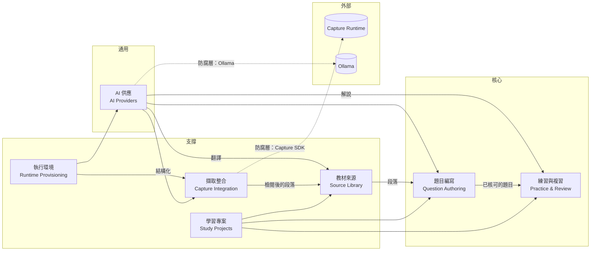
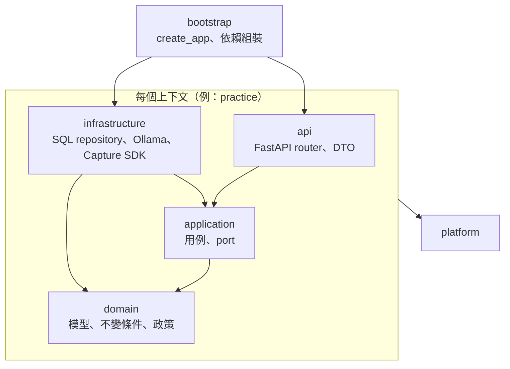

# Cert Prep 領域驅動重構計畫（DDD）

狀態：**已核可**（2026-10-26）：產品負責人核可方向與產品決策，見 [decisions.md](decisions.md)；實作安排見第 10 節。結構比照 LAW 已定案的 DDD 重構計畫（`gx.law-prep/.agents/PLANS/ddd-refactor/`，決策 A30、A31）。待定的決策見 [decisions.md](decisions.md)，術語見 [glossary.md](glossary.md)，每個上下文的說明見 [docs/domain/](../../../docs/domain/README.md)。

這份文件給產品負責人和之後加入的人讀。程式名稱用英文，說明用繁體中文。數字取自 2026-10-26 對 `origin/main`（`826b49b`）的唯讀盤點。

## 1. 為什麼要重構

後端已有 `domains/<domain>/` 的切法（[backend-architecture.md](../../SPECS/domains/backend-architecture.md) 的 DDD And SOLID Refactor Policy），沒有模組循環，領域檔案也不直接 import FastAPI。但邊界只靠慣例，以下幾點讓「規則在哪裡、改一處會動到哪裡」看不清楚：

| 現況                                                                                                                                                                             | 影響                                                   |
| -------------------------------------------------------------------------------------------------------------------------------------------------------------------------------- | ------------------------------------------------------ |
| 23 個領域檔案 import `cert_prep_backend.api.errors`，它 import `fastapi.HTTPException`；`api` 又 import 這些領域                                                                 | 領域依賴 Web 框架；`api` 與四個領域套件互相依賴        |
| 練習直接讀 `question_drafts`；題目產生執行 `UPDATE documents`；教材處理執行 `DELETE FROM draft_generation_jobs`                                                                  | 一張表由幾個上下文各自下 SQL，改欄位要找遍三處         |
| `routers/capture_workbench.py` 1,652 行：DTO、SSE 註冊、狀態檢查、409／422 業務判斷、雜湊比對、送背景工作                                                                        | 擷取的業務規則藏在 HTTP 層，沒有自己的單元測試         |
| `mock_exams.ports.DraftGenerationProvider` 被擷取、練習、執行環境三個套件 import；Ollama 用戶端也在 `mock_exams` 裡                                                              | AI 供應者看起來屬於題目產生，其他功能都得依賴題目產生  |
| 前端只有技術分層（`components`、`stores`、`pages`）：42 個 root store，`practice.store` 注入 5 個 store、`workspace.facade` 注入 8 個；`stores/capture-runtime` 反向 import 頁面 | 看不出一個功能由哪些檔案組成，store 之間的依賴沒有方向 |
| 除了 Nx 專案層級的 `scope` 標籤，沒有自動檢查；Angular app 內的資料夾、Python 套件之間、Rust 模組之間都沒有                                                                      | 邊界只靠審查，新的違規不會被擋下                       |

## 2. 目標

1. **依業務意義分上下文**：七個上下文加一個平台（第 3 節）。名稱與用語依 [glossary.md](glossary.md)。
2. **上下文內分層**：`domain`（模型、不變條件、政策）、`application`（用例、對外的 port）、`infrastructure`（SQL、Ollama、Capture SDK、檔案）、`api`（FastAPI router 與 DTO）。只建有內容的層，不為了資料夾名稱加空殼。
3. **規則集中在 domain**：純 Python，不 import FastAPI、sqlite3、httpx、ollama、Capture SDK；有自己的單元測試。
4. **資料表各有所屬**：每張表屬於一個上下文；別的上下文經它的 `application` 讀寫，不直接下 SQL。
5. **自動檢查守住結構**：後端用 import-linter，前端用 Sheriff，Rust 用模組可見性。既有違規先列為已知例外，只擋新增的違規，每個步驟縮小例外清單。
6. **給人讀的文件**：每個上下文一份 `docs/domain/<上下文>.md`，圖用 Mermaid。

不在這次範圍（沿用 backend-architecture 的 Deferred）：換 ORM、改資料表結構、改 REST／OpenAPI、改 Tauri 指令或 package QA JSON、改畫面。

## 3. 上下文地圖



實線箭頭表示資料由上游流向下游：下游使用上游公開的資料，上游不知道下游。虛線箭頭是**防腐層**：外部格式只在這一層轉換。

| 上下文     | 套件（重構後）         | 負責                                                          | 主要模型                                                | 現在的程式                                                                          |
| ---------- | ---------------------- | ------------------------------------------------------------- | ------------------------------------------------------- | ----------------------------------------------------------------------------------- |
| 學習專案   | `projects`             | 專案身分與範圍                                                | `Project`                                               | `domains/projects`、`routers/projects`；前端 `project.store`、`project-rail`        |
| 教材來源   | `source_library`       | 匯入檔案、儲存、段落、匯入作業、音訊翻譯                      | `SourceDocument`、`DocumentChunk`、`DocumentOperation`  | `domains/source_documents`、`routers/documents`；前端 `stores/source-import`        |
| 擷取整合   | `capture_integration`  | Capture Runtime 的擷取、檢閱、確認後寫入教材                  | `CaptureReviewSession`                                  | `domains/capture_workbench`、`routers/capture_workbench`、`routers/capture_runtime` |
| 題目編寫   | `authoring`            | 解析、產生與編修題目草稿、產生工作                            | `QuestionDraft`、`DraftGenerationJob`、`ContentProfile` | `domains/mock_exams`（模型、repository、parser、streaming）、`exam_content`         |
| 練習與複習 | `practice`             | 練習、作答、錯題、解說                                        | `PracticeSession`、`PracticeAttempt`、`WrongAnswer`     | `domains/practice`、`routers/practice`；前端 `stores/practice`                      |
| AI 供應    | `ai_providers`         | 選擇與呼叫 LLM、模型清單、假供應者                            | `DraftGenerationProvider`（port）                       | `mock_exams` 的 provider*、ollama\_*、fake_provider；`packages/cert-prep-ollama`    |
| 執行環境   | `runtime_provisioning` | 安裝與檢查 Capture Runtime、Ollama 等元件                     | `RuntimeInstallationJob`                                | `domains/runtime_installations`、`routers/runtime`；Tauri crate                     |
| 平台       | `platform`             | 設定、錯誤型別、資料庫與 migration、SSE、作業事件、背景工作池 | —                                                       | `core/`、`persistence/`、`api/sse`、`operation_events`                              |

## 4. 程式結構

```text
apps/cert-prep-backend/src/cert_prep_backend/
  platform/                 設定、錯誤、資料庫與 migration、SSE、作業事件、背景工作池
  projects/                 domain/  application/  infrastructure/  api/
  source_library/
  capture_integration/
  authoring/
  practice/
  ai_providers/
  runtime_provisioning/
  bootstrap/                create_app、依賴組裝（唯一可以 import 全部的地方）

apps/cert-prep/src/app/
  core/                     殼層、路由、攔截器、作業事件
  projects/  source-library/  capture/  authoring/  practice/  runtime/
                            各自 feature/ ui/ data/ domain/，對外只經 index.ts
```



## 5. 自動檢查

| 範圍     | 工具                                                                                                     | 規則                                                                                                                                                                                                                                              |
| -------- | -------------------------------------------------------------------------------------------------------- | ------------------------------------------------------------------------------------------------------------------------------------------------------------------------------------------------------------------------------------------------- | --- | ---- | ------------------------------------------------------------------------------------------------- |
| 後端     | import-linter（`apps/cert-prep-backend/pyproject.toml`，Nx target `lint-architecture`，CI 的 lint 步驟） | 每個上下文 `api`／`infrastructure` → `application` → `domain`；`domain` 不 import FastAPI、starlette、sqlite3、httpx、ollama、`capture_runtime_client`；上下文只依地圖方向引用，不引用別人的 `infrastructure`、`api`；`platform` 不引用任何上下文 |
| 前端     | Sheriff（`sheriff.config.ts`，經 `@softarc/eslint-plugin-sheriff` 跑在既有 ESLint）                      | 資料夾標上 `context:*` 與 `layer:feature                                                                                                                                                                                                          | ui  | data | domain`；`feature`→`ui`、`data`、`domain`，`data`→`domain`；上下文之間只經 `index.ts`、依地圖方向 |
| Nx 專案  | 既有 `@nx/enforce-module-boundaries`                                                                     | 把目前不生效的 `type:data` 規則改成實際的標籤規則（`type:app` → `type:api`、`scope:shared`）                                                                                                                                                      |
| Rust     | 模組可見性（`pub(crate)`）與 `src-tauri` 一個允許清單測試                                                | `backend.rs` 不再是所有模組的中心；排在最後                                                                                                                                                                                                       |
| 已知例外 | import-linter `ignore_imports`、ESLint bulk suppressions                                                 | 規則上線時把現有違規逐條列入，每個 PR 只能減少；新增違規讓 CI 失敗                                                                                                                                                                                |

## 6. 遷移步驟

每一步都是可以單獨合併、跑完全部檢查的 PR。凡是搬套件的步驟，另外要通過第 7 節的打包版檢查。

| 步驟 | 內容                                                                                                                                          | 驗證                                                                   |
| ---- | --------------------------------------------------------------------------------------------------------------------------------------------- | ---------------------------------------------------------------------- |
| C0   | 本文件、[decisions.md](decisions.md)、[glossary.md](glossary.md)、`docs/domain/` 骨架                                                         | 產品負責人核可                                                         |
| C1   | import-linter 與 Sheriff 上線，規則依現有套件與資料夾寫，現有違規列為已知例外                                                                 | 故意加一個違規時 CI 失敗；既有測試全過                                 |
| C2   | 平台：錯誤型別改由 `platform`（原 `core/exceptions`）提供，領域不再 import `api.errors`；資料庫、migration、SSE、作業事件移到 `platform`      | `api` 與領域之間的套件循環歸零；OpenAPI 與產生的 client 不變           |
| C3   | 依上下文機械式搬移（每個上下文一個 PR）：學習專案 → 練習與複習 → 教材來源 → 題目編寫 → AI 供應 → 擷取整合 → 執行環境；router 移到各自的 `api` | 逐檔比對只差 import；OpenAPI 與 client 逐 byte 相同；第 7 節打包版檢查 |
| C4   | 資料表歸屬：跨上下文的 SQL 改經所屬上下文的 `application`（練習讀題目、題目產生改教材狀態、教材刪產生工作）                                   | 特性測試（characterization test）先寫；資料庫內容與 API 行為不變       |
| C5   | 擷取整合的業務規則從 router 移到 `application`／`domain`（`commit_capture` 等）；`api` 只轉換 DTO 與錯誤                                      | 規則的單元測試；HTTP 測試不變                                          |
| C6   | 前端依上下文分資料夾，store 依上下文分組，修正反向 import；Sheriff 規則全面生效                                                               | 單元測試、Playwright e2e；已知例外清單縮小                             |
| C7   | Rust：`backend.rs` 拆分，模組改 `pub(crate)`，加允許清單測試                                                                                  | cargo test；桌面打包版啟動                                             |
| C8   | 每個上下文的 `docs/domain/<上下文>.md` 補齊（隨 C3–C6 同一個 PR 更新）                                                                        | 文件審閱                                                               |

## 7. 每個 PR 的驗證

- `pnpm nx run-many -t lint test` 全過，含新的 `lint-architecture`。
- 重新產生 OpenAPI 與 `libs/cert-prep-api` client，和 main 逐 byte 相同（router 的函式名稱、tag、路徑都會影響 operation id，搬移時不改）。
- package QA 與 Playwright e2e 全過。
- 搬套件的 PR：建置桌面打包版，在全新資料目錄與既有資料目錄上啟動、匯入一份 PDF、產生題目、練習一次，確認資料讀得回來（比照 LAW A28）。

## 8. 工作量與風險

| 步驟  | 估計（含驗證）  | 主要風險                                                                                                                                                                                                                                                       |
| ----- | --------------- | -------------------------------------------------------------------------------------------------------------------------------------------------------------------------------------------------------------------------------------------------------------- |
| C1–C2 | 1–2 天          | 例外清單太長看不出重點：依上下文分組列出；`create_app` 移到 `bootstrap` 時，`scripts/build_backend_runtime.py` 的 hidden import（`cert_prep_backend.api.app`）、`serve` target 與打包入口 `entrypoints/backend_runtime.py` 同一個 PR 更新                      |
| C3    | 4–6 天，7 個 PR | 測試以字串 monkeypatch 模組路徑；`tools/capture-runtime-consumer-source.mts` 與 `capture-runtime-version-check.mts` 以檔案路徑列出 `domains/capture_workbench/*.py`，Capture Workbench 的 consumer gate 也跑它們，搬移時同一個 PR 更新；與進行中的功能分支衝突 |
| C4–C5 | 3–4 天          | 交易邊界：跨上下文的寫入原本在同一個 SQL 交易，改經 application 後仍要在同一個交易                                                                                                                                                                             |
| C6    | 3–4 天          | root store 的注入順序與 effect 時序；e2e 是主要防線                                                                                                                                                                                                            |
| C7    | 1–2 天          | 行程管理（後端與 Capture Runtime 的啟停）不能退步                                                                                                                                                                                                              |

合計約 2.5–3.5 週、15–20 個 PR。目前本機 `cert-prep` 的 main 有未提交的修改（`domains/mock_exams`、`exam_content`），C3 搬題目編寫前要先合併或另行處理，以免衝突。

## 9. 給人讀的文件

每個上下文一份 `docs/domain/<上下文>.md`，固定段落：負責與不負責、用語、聚合與不變條件（類別圖）、主要流程（狀態圖或循序圖）、與其他上下文的關係、規則與資料來源。圖用 Mermaid 寫在 Markdown 裡；改程式時在同一個 PR 更新圖。

## 10. 實作安排

產品負責人於 2026-10-26 核可：規則先在兩個 repo 並行上線，搬移先做 Cert Prep；Capture 等 Cert Prep 與 LAW 換到 0.7.2 之後才開始搬移；機械式搬移派給其他 worker，由 Claude 驗證。

| 順序 | Cert Prep                             | Capture Workbench                  | 誰做                                 |
| ---- | ------------------------------------- | ---------------------------------- | ------------------------------------ |
| 1    | C1 規則與已知例外                     | W1 規則與已知例外                  | Claude                               |
| 2    | C2 平台（錯誤型別、資料庫）           | —                                  | Claude                               |
| 3    | C3 依上下文搬移（7 個 PR）            | —                                  | worker 搬移，Claude 審查、驗證、合併 |
| 4    | C4 資料表歸屬、C5 擷取規則移出 router | W2–W4 拆大檔（engine_adapters 等） | Claude                               |
| 5    | C6 前端依上下文分資料夾               | W5 依上下文搬移（6 個 PR）         | worker 搬移，Claude 審查、驗證、合併 |
| 6    | C7 Rust                               | W6–W8                              | Claude；W7、W8 的搬移部分可派工      |

派工的規則：每個 worker 在自己的 git worktree 工作、不自動核准任何指令、不 commit 也不 push；同時最多兩個；建置、測試與安裝都由 Claude 執行，並檢查 worktree 以外沒有任何變動。worker 交回的是搬移與 import 的修改，第 7 節的驗證全部由 Claude 跑過才開 PR。
