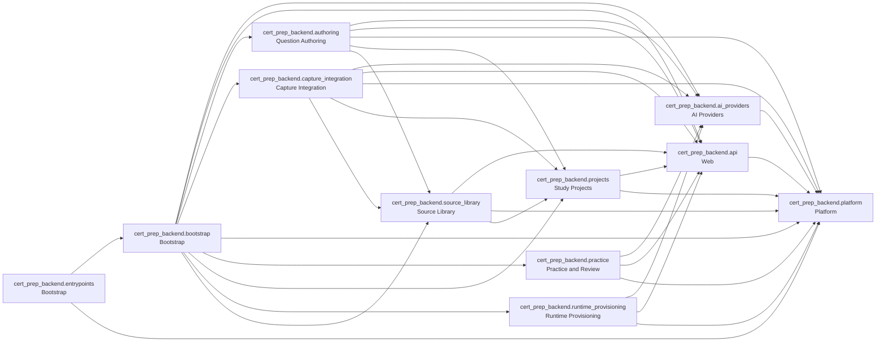

<!-- Generated by tools/architecture-graph.mts --write. Do not edit by hand. -->
# Backend contexts

Each node is a top-level package of the `cert_prep_backend` Python package, labelled with its bounded context from `.agents/PLANS/ddd-refactor/README.md` (`api` holds the shared HTTP errors and bearer auth, `bootstrap` assembles the app and `entrypoints` start it). An arrow `a --> b` means a module in `a` imports a module in `b` (from grimp); imports inside one package are not drawn. The rules are the import-linter contracts in `apps/cert-prep-backend/pyproject.toml`.

