<!-- Generated by tools/architecture-graph.mts --write. Do not edit by hand. -->
# UI modules

Each node is a Sheriff module (`sheriff.config.ts`) of the Angular app, the Spartan UI libraries, or the generated API client, labelled with its Sheriff tags; `root` holds files outside every module. An arrow `a --> b` means a TypeScript file in `a` imports a file in `b`. Tests and test helpers are not drawn.

```mermaid
flowchart LR
  n_apps_cert_prep_src_app_components_app["apps/cert-prep/src/app/components/app<br/>layer:component"]
  n_apps_cert_prep_src_app_components_draft_review_panel["apps/cert-prep/src/app/components/draft-review-panel<br/>layer:component"]
  n_apps_cert_prep_src_app_components_model_health["apps/cert-prep/src/app/components/model-health<br/>layer:component"]
  n_apps_cert_prep_src_app_components_practice_panel["apps/cert-prep/src/app/components/practice-panel<br/>layer:component"]
  n_apps_cert_prep_src_app_components_project_rail["apps/cert-prep/src/app/components/project-rail<br/>layer:component"]
  n_apps_cert_prep_src_app_components_source_import_panel["apps/cert-prep/src/app/components/source-import-panel<br/>layer:component"]
  n_apps_cert_prep_src_app_components_ui["apps/cert-prep/src/app/components/ui<br/>layer:ui"]
  n_apps_cert_prep_src_app_components_wrong_answer_dashboard["apps/cert-prep/src/app/components/wrong-answer-dashboard<br/>layer:component"]
  n_apps_cert_prep_src_app_components_wrong_answer_review["apps/cert-prep/src/app/components/wrong-answer-review<br/>layer:component"]
  n_apps_cert_prep_src_app_constants["apps/cert-prep/src/app/constants<br/>layer:constant"]
  n_apps_cert_prep_src_app_contracts["apps/cert-prep/src/app/contracts<br/>layer:contract"]
  n_apps_cert_prep_src_app_guards["apps/cert-prep/src/app/guards<br/>layer:routing"]
  n_apps_cert_prep_src_app_interceptors["apps/cert-prep/src/app/interceptors<br/>layer:routing"]
  n_apps_cert_prep_src_app_pages_build_workbench["apps/cert-prep/src/app/pages/build-workbench<br/>layer:page"]
  n_apps_cert_prep_src_app_pages_capture_workbench_trial["apps/cert-prep/src/app/pages/capture-workbench-trial<br/>layer:page"]
  n_apps_cert_prep_src_app_pages_dashboard["apps/cert-prep/src/app/pages/dashboard<br/>layer:page"]
  n_apps_cert_prep_src_app_pages_full_exam["apps/cert-prep/src/app/pages/full-exam<br/>layer:page"]
  n_apps_cert_prep_src_app_pages_random_quiz["apps/cert-prep/src/app/pages/random-quiz<br/>layer:page"]
  n_apps_cert_prep_src_app_pages_runtime_manager["apps/cert-prep/src/app/pages/runtime-manager<br/>layer:page"]
  n_apps_cert_prep_src_app_pages_wrong_answer_review["apps/cert-prep/src/app/pages/wrong-answer-review<br/>layer:page"]
  n_apps_cert_prep_src_app_services["apps/cert-prep/src/app/services<br/>layer:service"]
  n_apps_cert_prep_src_app_stores["apps/cert-prep/src/app/stores<br/>layer:store"]
  n_apps_cert_prep_src_app_stores_capture_runtime["apps/cert-prep/src/app/stores/capture-runtime<br/>layer:store"]
  n_apps_cert_prep_src_app_stores_desktop_runtime["apps/cert-prep/src/app/stores/desktop-runtime<br/>layer:store"]
  n_apps_cert_prep_src_app_stores_draft_review["apps/cert-prep/src/app/stores/draft-review<br/>layer:store"]
  n_apps_cert_prep_src_app_stores_health["apps/cert-prep/src/app/stores/health<br/>layer:store"]
  n_apps_cert_prep_src_app_stores_operation["apps/cert-prep/src/app/stores/operation<br/>layer:store"]
  n_apps_cert_prep_src_app_stores_practice["apps/cert-prep/src/app/stores/practice<br/>layer:store"]
  n_apps_cert_prep_src_app_stores_source_import["apps/cert-prep/src/app/stores/source-import<br/>layer:store"]
  n_apps_cert_prep_src_app_stores_wrong_answer_review["apps/cert-prep/src/app/stores/wrong-answer-review<br/>layer:store"]
  n_libs_cert_prep_api_src["libs/cert-prep-api/src<br/>layer:api-client"]
  n_libs_ui_badge_src["libs/ui/badge/src<br/>layer:shared-ui"]
  n_libs_ui_button_src["libs/ui/button/src<br/>layer:shared-ui"]
  n_libs_ui_dialog_src["libs/ui/dialog/src<br/>layer:shared-ui"]
  n_libs_ui_input_src["libs/ui/input/src<br/>layer:shared-ui"]
  n_libs_ui_progress_src["libs/ui/progress/src<br/>layer:shared-ui"]
  n_libs_ui_switch_src["libs/ui/switch/src<br/>layer:shared-ui"]
  n_libs_ui_textarea_src["libs/ui/textarea/src<br/>layer:shared-ui"]
  n_libs_ui_utils_src["libs/ui/utils/src<br/>layer:shared-ui"]
  n_root["root<br/>root"]
  n_apps_cert_prep_src_app_components_app --> n_apps_cert_prep_src_app_components_model_health
  n_apps_cert_prep_src_app_components_app --> n_apps_cert_prep_src_app_components_project_rail
  n_apps_cert_prep_src_app_components_app --> n_apps_cert_prep_src_app_components_ui
  n_apps_cert_prep_src_app_components_app --> n_apps_cert_prep_src_app_constants
  n_apps_cert_prep_src_app_components_app --> n_apps_cert_prep_src_app_contracts
  n_apps_cert_prep_src_app_components_app --> n_apps_cert_prep_src_app_pages_runtime_manager
  n_apps_cert_prep_src_app_components_app --> n_apps_cert_prep_src_app_stores
  n_apps_cert_prep_src_app_components_app --> n_apps_cert_prep_src_app_stores_desktop_runtime
  n_apps_cert_prep_src_app_components_draft_review_panel --> n_apps_cert_prep_src_app_components_ui
  n_apps_cert_prep_src_app_components_draft_review_panel --> n_apps_cert_prep_src_app_services
  n_apps_cert_prep_src_app_components_draft_review_panel --> n_apps_cert_prep_src_app_stores
  n_apps_cert_prep_src_app_components_draft_review_panel --> n_apps_cert_prep_src_app_stores_draft_review
  n_apps_cert_prep_src_app_components_draft_review_panel --> n_apps_cert_prep_src_app_stores_source_import
  n_apps_cert_prep_src_app_components_draft_review_panel --> n_libs_ui_input_src
  n_apps_cert_prep_src_app_components_model_health --> n_apps_cert_prep_src_app_components_ui
  n_apps_cert_prep_src_app_components_model_health --> n_apps_cert_prep_src_app_contracts
  n_apps_cert_prep_src_app_components_model_health --> n_apps_cert_prep_src_app_stores_desktop_runtime
  n_apps_cert_prep_src_app_components_model_health --> n_apps_cert_prep_src_app_stores_health
  n_apps_cert_prep_src_app_components_model_health --> n_libs_ui_badge_src
  n_apps_cert_prep_src_app_components_model_health --> n_libs_ui_dialog_src
  n_apps_cert_prep_src_app_components_practice_panel --> n_apps_cert_prep_src_app_components_ui
  n_apps_cert_prep_src_app_components_practice_panel --> n_apps_cert_prep_src_app_contracts
  n_apps_cert_prep_src_app_components_practice_panel --> n_apps_cert_prep_src_app_services
  n_apps_cert_prep_src_app_components_practice_panel --> n_apps_cert_prep_src_app_stores
  n_apps_cert_prep_src_app_components_practice_panel --> n_apps_cert_prep_src_app_stores_draft_review
  n_apps_cert_prep_src_app_components_practice_panel --> n_apps_cert_prep_src_app_stores_practice
  n_apps_cert_prep_src_app_components_practice_panel --> n_apps_cert_prep_src_app_stores_source_import
  n_apps_cert_prep_src_app_components_project_rail --> n_apps_cert_prep_src_app_components_ui
  n_apps_cert_prep_src_app_components_project_rail --> n_apps_cert_prep_src_app_stores
  n_apps_cert_prep_src_app_components_project_rail --> n_libs_ui_input_src
  n_apps_cert_prep_src_app_components_project_rail --> n_libs_ui_textarea_src
  n_apps_cert_prep_src_app_components_source_import_panel --> n_apps_cert_prep_src_app_components_ui
  n_apps_cert_prep_src_app_components_source_import_panel --> n_apps_cert_prep_src_app_constants
  n_apps_cert_prep_src_app_components_source_import_panel --> n_apps_cert_prep_src_app_contracts
  n_apps_cert_prep_src_app_components_source_import_panel --> n_apps_cert_prep_src_app_stores
  n_apps_cert_prep_src_app_components_source_import_panel --> n_apps_cert_prep_src_app_stores_draft_review
  n_apps_cert_prep_src_app_components_source_import_panel --> n_apps_cert_prep_src_app_stores_source_import
  n_apps_cert_prep_src_app_components_source_import_panel --> n_libs_ui_badge_src
  n_apps_cert_prep_src_app_components_source_import_panel --> n_libs_ui_dialog_src
  n_apps_cert_prep_src_app_components_source_import_panel --> n_libs_ui_switch_src
  n_apps_cert_prep_src_app_components_ui --> n_libs_ui_button_src
  n_apps_cert_prep_src_app_components_wrong_answer_dashboard --> n_apps_cert_prep_src_app_components_ui
  n_apps_cert_prep_src_app_components_wrong_answer_dashboard --> n_apps_cert_prep_src_app_contracts
  n_apps_cert_prep_src_app_components_wrong_answer_dashboard --> n_apps_cert_prep_src_app_services
  n_apps_cert_prep_src_app_components_wrong_answer_dashboard --> n_apps_cert_prep_src_app_stores
  n_apps_cert_prep_src_app_components_wrong_answer_dashboard --> n_apps_cert_prep_src_app_stores_practice
  n_apps_cert_prep_src_app_components_wrong_answer_dashboard --> n_apps_cert_prep_src_app_stores_source_import
  n_apps_cert_prep_src_app_components_wrong_answer_review --> n_apps_cert_prep_src_app_components_ui
  n_apps_cert_prep_src_app_components_wrong_answer_review --> n_apps_cert_prep_src_app_contracts
  n_apps_cert_prep_src_app_components_wrong_answer_review --> n_apps_cert_prep_src_app_services
  n_apps_cert_prep_src_app_components_wrong_answer_review --> n_apps_cert_prep_src_app_stores
  n_apps_cert_prep_src_app_components_wrong_answer_review --> n_apps_cert_prep_src_app_stores_draft_review
  n_apps_cert_prep_src_app_components_wrong_answer_review --> n_apps_cert_prep_src_app_stores_practice
  n_apps_cert_prep_src_app_components_wrong_answer_review --> n_apps_cert_prep_src_app_stores_source_import
  n_apps_cert_prep_src_app_constants --> n_apps_cert_prep_src_app_contracts
  n_apps_cert_prep_src_app_constants --> n_apps_cert_prep_src_app_guards
  n_apps_cert_prep_src_app_constants --> n_apps_cert_prep_src_app_interceptors
  n_apps_cert_prep_src_app_constants --> n_apps_cert_prep_src_app_pages_build_workbench
  n_apps_cert_prep_src_app_constants --> n_apps_cert_prep_src_app_pages_capture_workbench_trial
  n_apps_cert_prep_src_app_constants --> n_apps_cert_prep_src_app_pages_dashboard
  n_apps_cert_prep_src_app_constants --> n_apps_cert_prep_src_app_pages_full_exam
  n_apps_cert_prep_src_app_constants --> n_apps_cert_prep_src_app_pages_random_quiz
  n_apps_cert_prep_src_app_constants --> n_apps_cert_prep_src_app_pages_runtime_manager
  n_apps_cert_prep_src_app_constants --> n_apps_cert_prep_src_app_pages_wrong_answer_review
  n_apps_cert_prep_src_app_constants --> n_apps_cert_prep_src_app_services
  n_apps_cert_prep_src_app_constants --> n_libs_cert_prep_api_src
  n_apps_cert_prep_src_app_contracts --> n_apps_cert_prep_src_app_components_ui
  n_apps_cert_prep_src_app_contracts --> n_libs_cert_prep_api_src
  n_apps_cert_prep_src_app_guards --> n_apps_cert_prep_src_app_stores_desktop_runtime
  n_apps_cert_prep_src_app_interceptors --> n_apps_cert_prep_src_app_services
  n_apps_cert_prep_src_app_pages_build_workbench --> n_apps_cert_prep_src_app_components_draft_review_panel
  n_apps_cert_prep_src_app_pages_build_workbench --> n_apps_cert_prep_src_app_components_source_import_panel
  n_apps_cert_prep_src_app_pages_build_workbench --> n_apps_cert_prep_src_app_components_ui
  n_apps_cert_prep_src_app_pages_capture_workbench_trial --> n_apps_cert_prep_src_app_components_ui
  n_apps_cert_prep_src_app_pages_capture_workbench_trial --> n_apps_cert_prep_src_app_constants
  n_apps_cert_prep_src_app_pages_capture_workbench_trial --> n_apps_cert_prep_src_app_services
  n_apps_cert_prep_src_app_pages_capture_workbench_trial --> n_apps_cert_prep_src_app_stores
  n_apps_cert_prep_src_app_pages_capture_workbench_trial --> n_apps_cert_prep_src_app_stores_capture_runtime
  n_apps_cert_prep_src_app_pages_capture_workbench_trial --> n_apps_cert_prep_src_app_stores_desktop_runtime
  n_apps_cert_prep_src_app_pages_capture_workbench_trial --> n_apps_cert_prep_src_app_stores_source_import
  n_apps_cert_prep_src_app_pages_capture_workbench_trial --> n_libs_cert_prep_api_src
  n_apps_cert_prep_src_app_pages_dashboard --> n_apps_cert_prep_src_app_components_wrong_answer_dashboard
  n_apps_cert_prep_src_app_pages_full_exam --> n_apps_cert_prep_src_app_components_practice_panel
  n_apps_cert_prep_src_app_pages_random_quiz --> n_apps_cert_prep_src_app_components_practice_panel
  n_apps_cert_prep_src_app_pages_runtime_manager --> n_apps_cert_prep_src_app_components_model_health
  n_apps_cert_prep_src_app_pages_runtime_manager --> n_apps_cert_prep_src_app_components_ui
  n_apps_cert_prep_src_app_pages_runtime_manager --> n_apps_cert_prep_src_app_stores
  n_apps_cert_prep_src_app_pages_runtime_manager --> n_apps_cert_prep_src_app_stores_desktop_runtime
  n_apps_cert_prep_src_app_pages_runtime_manager --> n_apps_cert_prep_src_app_stores_health
  n_apps_cert_prep_src_app_pages_runtime_manager --> n_libs_ui_progress_src
  n_apps_cert_prep_src_app_pages_wrong_answer_review --> n_apps_cert_prep_src_app_components_wrong_answer_review
  n_apps_cert_prep_src_app_services --> n_apps_cert_prep_src_app_constants
  n_apps_cert_prep_src_app_services --> n_apps_cert_prep_src_app_contracts
  n_apps_cert_prep_src_app_services --> n_libs_cert_prep_api_src
  n_apps_cert_prep_src_app_stores --> n_apps_cert_prep_src_app_constants
  n_apps_cert_prep_src_app_stores --> n_apps_cert_prep_src_app_contracts
  n_apps_cert_prep_src_app_stores --> n_apps_cert_prep_src_app_services
  n_apps_cert_prep_src_app_stores --> n_apps_cert_prep_src_app_stores_desktop_runtime
  n_apps_cert_prep_src_app_stores --> n_apps_cert_prep_src_app_stores_draft_review
  n_apps_cert_prep_src_app_stores --> n_apps_cert_prep_src_app_stores_health
  n_apps_cert_prep_src_app_stores --> n_apps_cert_prep_src_app_stores_operation
  n_apps_cert_prep_src_app_stores --> n_apps_cert_prep_src_app_stores_practice
  n_apps_cert_prep_src_app_stores --> n_apps_cert_prep_src_app_stores_source_import
  n_apps_cert_prep_src_app_stores --> n_apps_cert_prep_src_app_stores_wrong_answer_review
  n_apps_cert_prep_src_app_stores_capture_runtime --> n_apps_cert_prep_src_app_pages_capture_workbench_trial
  n_apps_cert_prep_src_app_stores_desktop_runtime --> n_apps_cert_prep_src_app_services
  n_apps_cert_prep_src_app_stores_desktop_runtime --> n_apps_cert_prep_src_app_stores
  n_apps_cert_prep_src_app_stores_draft_review --> n_apps_cert_prep_src_app_constants
  n_apps_cert_prep_src_app_stores_draft_review --> n_apps_cert_prep_src_app_contracts
  n_apps_cert_prep_src_app_stores_draft_review --> n_apps_cert_prep_src_app_services
  n_apps_cert_prep_src_app_stores_draft_review --> n_apps_cert_prep_src_app_stores
  n_apps_cert_prep_src_app_stores_draft_review --> n_apps_cert_prep_src_app_stores_health
  n_apps_cert_prep_src_app_stores_draft_review --> n_apps_cert_prep_src_app_stores_source_import
  n_apps_cert_prep_src_app_stores_health --> n_apps_cert_prep_src_app_constants
  n_apps_cert_prep_src_app_stores_health --> n_apps_cert_prep_src_app_contracts
  n_apps_cert_prep_src_app_stores_health --> n_apps_cert_prep_src_app_services
  n_apps_cert_prep_src_app_stores_health --> n_apps_cert_prep_src_app_stores
  n_apps_cert_prep_src_app_stores_practice --> n_apps_cert_prep_src_app_constants
  n_apps_cert_prep_src_app_stores_practice --> n_apps_cert_prep_src_app_contracts
  n_apps_cert_prep_src_app_stores_practice --> n_apps_cert_prep_src_app_services
  n_apps_cert_prep_src_app_stores_practice --> n_apps_cert_prep_src_app_stores
  n_apps_cert_prep_src_app_stores_practice --> n_apps_cert_prep_src_app_stores_draft_review
  n_apps_cert_prep_src_app_stores_practice --> n_apps_cert_prep_src_app_stores_source_import
  n_apps_cert_prep_src_app_stores_source_import --> n_apps_cert_prep_src_app_constants
  n_apps_cert_prep_src_app_stores_source_import --> n_apps_cert_prep_src_app_contracts
  n_apps_cert_prep_src_app_stores_source_import --> n_apps_cert_prep_src_app_services
  n_apps_cert_prep_src_app_stores_source_import --> n_apps_cert_prep_src_app_stores
  n_libs_ui_badge_src --> n_libs_ui_utils_src
  n_libs_ui_button_src --> n_libs_ui_utils_src
  n_libs_ui_dialog_src --> n_libs_ui_button_src
  n_libs_ui_dialog_src --> n_libs_ui_utils_src
  n_libs_ui_input_src --> n_libs_ui_utils_src
  n_libs_ui_progress_src --> n_libs_ui_utils_src
  n_libs_ui_switch_src --> n_libs_ui_utils_src
  n_libs_ui_textarea_src --> n_libs_ui_utils_src
  n_root --> n_apps_cert_prep_src_app_components_app
  n_root --> n_apps_cert_prep_src_app_constants
```

