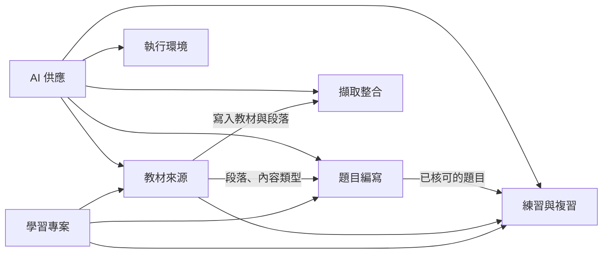

# Cert Prep 的領域模型

Cert Prep 依業務的意義分成幾個「上下文」，每個上下文負責一塊業務，有自己的模型、規則和用語。這個目錄給要理解或參與設計的人讀：每個上下文一份說明，圖用 Mermaid 畫，在 GitHub 上直接顯示。

- 用語對照：[glossary.md](../../.agents/PLANS/ddd-refactor/glossary.md)
- 為什麼這樣切、怎麼遷移：[DDD 重構計畫](../../.agents/PLANS/ddd-refactor/README.md)、[決策](../../.agents/PLANS/ddd-refactor/decisions.md)

## 上下文

| 上下文     | 說明文件                                         | 程式（重構後）                                           | 狀態    |
| ---------- | ------------------------------------------------ | -------------------------------------------------------- | ------- |
| 學習專案   | [projects.md](projects.md)                       | `cert_prep_backend/projects`、`app/projects`             | C4 完成 |
| 教材來源   | [source_library.md](source_library.md)           | `cert_prep_backend/source_library`、`app/source-library` | C4 完成 |
| 擷取整合   | [capture_integration.md](capture_integration.md) | `cert_prep_backend/capture_integration`、`app/capture`   | C4 完成 |
| 題目編寫   | [authoring.md](authoring.md)                     | `cert_prep_backend/authoring`、`app/authoring`           | C4 完成 |
| 練習與複習 | [practice.md](practice.md)                       | `cert_prep_backend/practice`、`app/practice`             | C4 完成 |
| AI 供應    | [ai_providers.md](ai_providers.md)               | `cert_prep_backend/ai_providers`                         | C4 完成 |
| 執行環境   | [runtime_provisioning.md](runtime_provisioning.md) | `cert_prep_backend/runtime_provisioning`、`app/runtime`  | C4 完成 |

實線箭頭由上游指向下游：下游使用上游公開的介面與資料，上游不知道下游。

## 每份說明的固定段落

1. 負責什麼、不負責什麼
2. 用語（連到 glossary）
3. 聚合與不變條件（類別圖）
4. 主要流程（狀態圖、循序圖）
5. 與其他上下文的關係
6. 規則與資料來源

改程式時，在同一個 PR 更新對應的說明與圖。
