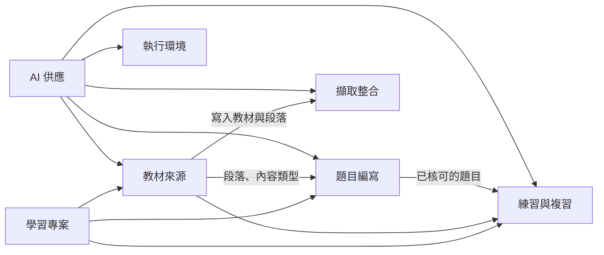

# Cert Prep 的領域模型

Cert Prep 依業務的意義分成幾個「上下文」，每個上下文負責一塊業務，有自己的模型、規則和用語。這個目錄給要理解或參與設計的人讀：每個上下文一份說明，圖用 Mermaid 畫，在 GitHub 上直接顯示。

- 用語對照：[glossary.md](../../.agents/PLANS/ddd-refactor/glossary.md)
- 為什麼這樣切、怎麼遷移：[DDD 重構計畫](../../.agents/PLANS/ddd-refactor/README.md)、[決策](../../.agents/PLANS/ddd-refactor/decisions.md)

## 上下文

| 上下文     | 說明文件                                           | 後端程式                                 |
| ---------- | -------------------------------------------------- | ---------------------------------------- |
| 學習專案   | [projects.md](projects.md)                         | `cert_prep_backend/projects`             |
| 教材來源   | [source_library.md](source_library.md)             | `cert_prep_backend/source_library`       |
| 擷取整合   | [capture_integration.md](capture_integration.md)   | `cert_prep_backend/capture_integration`  |
| 題目編寫   | [authoring.md](authoring.md)                       | `cert_prep_backend/authoring`            |
| 練習與複習 | [practice.md](practice.md)                         | `cert_prep_backend/practice`             |
| AI 供應    | [ai_providers.md](ai_providers.md)                 | `cert_prep_backend/ai_providers`         |
| 執行環境   | [runtime_provisioning.md](runtime_provisioning.md) | `cert_prep_backend/runtime_provisioning` |

後端的上下文已完成語意模型（C4）與資料表歸屬（C5，https://github.com/gx-capture/capture-workbench/issues/200）。前端依上下文分資料夾是 C7（https://github.com/gx-capture/capture-workbench/issues/201）：目標結構是 `apps/cert-prep/src/app/<上下文>/{feature,ui,data,domain}` 加 `core/`，規則在 `sheriff.config.ts`。全 app 共用的程式已搬到 `core/`（`shell`、`ui`、`data`、`domain`），學習專案已搬到 `projects/`，教材來源已搬到 `source-library/`，擷取整合已搬到 `capture/`，執行環境的桌面端狀態（`DesktopRuntimeStore`）已搬到 `runtime/`，其餘仍在技術分層（`components`、`pages`、`stores`、`services`、`contracts`）。前端的 `runtime` 含 AI 供應的畫面（模型健康），是教材來源、擷取整合、題目編寫與練習的上游（[決策 D18](../../.agents/PLANS/ddd-refactor/decisions.md)）。

實線箭頭由上游指向下游：下游使用上游公開的介面與資料，上游不知道下游。

## 每份說明的固定段落

1. 負責什麼、不負責什麼
2. 用語（連到 glossary）
3. 聚合與不變條件（類別圖）
4. 主要流程（狀態圖、循序圖）
5. 與其他上下文的關係
6. 規則與資料來源

改程式時，在同一個 PR 更新對應的說明與圖。
