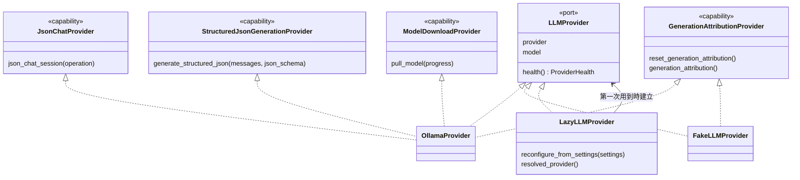
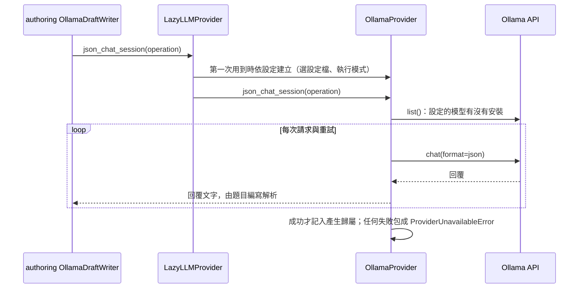

# AI 供應（AI Providers）

程式：`apps/cert-prep-backend/src/cert_prep_backend/ai_providers`。

## 負責與不負責

負責：依使用者的偏好選擇語言模型的供應者（Ollama 或假供應者）；檢查供應者與模型能不能用；為這台機器選 Ollama 模型設定檔與執行模式；盤點機器；以 JSON 模式和模型對話、產生結構化 JSON；延遲建立供應者，讓 app 啟動時不探測 Ollama。

不負責：寫題目草稿與它的 prompt（題目編寫）、錯題解說的內容（練習與複習）、擷取結果的結構化 prompt（擷取整合）、安裝 Ollama 與下載模型（執行環境）、翻譯錄音段落（教材來源，目前直接呼叫 Ollama）。

## 用語

| 中文               | 程式名稱                                   | 意思                                                           |
| ------------------ | ------------------------------------------ | -------------------------------------------------------------- |
| 供應者             | `LLMProvider`                              | 使用者設定的語言模型：哪個供應者、哪個模型、目前能不能用       |
| 供應者健康狀態     | `ProviderHealth`                           | 供應者與模型是否可用、為什麼不能用、用哪個設定檔與執行模式     |
| 供應者能力         | `provider_capability`                      | 供應者除了回報健康之外能做的事；延遲建立的供應者在查詢時才建立 |
| JSON 對話          | `JsonChatProvider`、`JsonChat`             | 以 JSON 模式和設定的模型對話；一個工作階段內模型只檢查一次     |
| 結構化 JSON        | `StructuredJsonGenerationProvider`         | 依 JSON schema 產生一個候選結果，原樣回傳不修正                |
| 模型下載           | `ModelDownloadProvider`                    | 使用者確認後下載設定的模型                                     |
| 模型上線檢查       | `ModelOnboardingProvider`                  | 下載前檢查執行環境、下載後確認模型能回應                       |
| 產生歸屬           | `GenerationAttributionProvider`            | 最近一次成功的產生實際用了哪個供應者與模型                     |
| 釋放資源           | `ResourceReleasingProvider`                | 串流產生工作結束後讓模型卸載                                   |
| 串流參數           | `StreamingGenerationOptionsProvider`       | 串流產生時供應者自己的呼叫參數，例如用完就卸載模型             |
| 產生時才啟動       | `StartsOnGenerationProvider`               | 產生時才啟動還沒執行的供應者執行環境                           |
| 需要安裝的執行環境 | `RuntimeInstallationProvider`              | 供應者需要在本機安裝的執行環境（Ollama）                       |
| 延遲建立的供應者   | `LazyLLMProvider`                          | 第一次用到時才依設定建立的供應者                               |
| 供應者偏好         | `LLMProviderPreference`                    | 使用者設定的偏好：自動、Ollama 或假供應者                      |
| 供應者選擇         | `LLMProviderSelection`、`select_provider`  | 偏好選中的供應者、實際使用的供應者，以及它需要安裝什麼         |
| 執行模式           | `LLMExecutionMode`                         | 模型用加速器（自動）或只用 CPU                                 |
| 模型設定檔         | `OllamaModelProfile`                       | 一個 Ollama 模型與它的參數、需要的記憶體與磁碟空間             |
| 設定檔選擇         | `OllamaProfileSelection`                   | 為這台機器選中的設定檔、備用設定檔與原因                       |
| 機器盤點           | `MachineInventory`、`MachineInventoryRead` | CPU、記憶體、儲存空間與加速器；用來選設定檔與執行模式          |

## 聚合與不變條件

- 供應者一定能回報健康狀態；其他能力都是選用的，以 `provider_capability` 查詢。延遲建立的供應者只轉發能力，查詢時才建立真正的供應者。
- 偏好是假供應者時才選假供應者；自動與 Ollama 都選 Ollama。選中 Ollama 時，它需要安裝 Ollama 與模型。
- JSON 對話的工作階段：開始前檢查一次模型；裡面任何失敗，包括讀回覆時的失敗，都當作模型呼叫失敗（「Ollama unavailable for configured model …」）；只有成功的工作階段記入產生歸屬。
- 只有供應者是 Ollama、而且設定檔啟用時才選設定檔；只有在選設定檔時才盤點機器。盤點結果保留 5 分鐘，要求重新盤點時才再量一次。
- 供應者不寫題目草稿：題目編寫用 JSON 對話自己寫（D14）。

## 用例

| 用例             | 程式名稱                  | 說明                                                   |
| ---------------- | ------------------------- | ------------------------------------------------------ |
| 檢查供應者       | `check_provider_health`   | 供應者與模型能不能用；Ollama 沒在執行時會先嘗試啟動它  |
| 查看供應者選擇   | `show_provider_selection` | 偏好選中的供應者，以及實際使用的供應者與模型           |
| 列出模型設定檔   | `list_model_profiles`     | 可以選的 Ollama 模型設定檔                             |
| 查看設定檔選擇   | `show_profile_selection`  | 為這台機器選中的設定檔；不適用時改用設定的模型         |
| 盤點機器         | `inspect_machine`         | 這台機器的 CPU、記憶體、儲存空間與加速器               |
| 選 Ollama 設定檔 | `choose_ollama_profile`   | 依設定與機器選設定檔；建立供應者與安裝設定檔模型時使用 |

## 主要流程

`create_app` 把 `lazy_provider_from_settings(settings)`（測試可以注入自己的供應者）放在 `app.state.llm_provider`，把 `OllamaMachineInventory(settings)` 放在 `app.state.machine_inventory`，並交給執行環境的 `RuntimeInstallationManager`。router 只呼叫 `application/use_cases.py` 的用例。

## 與其他上下文的關係

- 題目編寫：用 `draft_writer_for` 為設定的供應者挑選寫草稿者，Ollama 經 JSON 對話寫草稿；串流產生使用串流參數、產生歸屬與釋放資源。
- 練習與複習：用供應者的健康狀態決定能不能請模型解說錯題；解說能力 `PracticeExplanationProvider` 由練習與複習自己定義。
- 擷取整合：用結構化 JSON 整理擷取結果。
- 執行環境：用模型下載、模型上線檢查與需要安裝的執行環境安裝 Ollama 與模型；安裝設定檔模型時用 `choose_ollama_profile`；`/runtime/machine-inventory` 用 `inspect_machine`，回應用 AI 供應的 `MachineInventoryRead`（已知例外，D15）。`/llm/model-downloads` 是執行環境的端點（D14）。
- 教材來源：錄音段落的翻譯目前直接呼叫 Ollama（`source_library/infrastructure/audio.py`），還沒有經過 AI 供應。

其他上下文只能經 `ai_providers.application` 與 `ai_providers.domain` 使用 AI 供應（import-linter「Other contexts reach AI Providers only through its application and domain」），AI 供應不依賴任何其他上下文（「AI Providers does not depend on other contexts」）。

## 規則與資料來源

- 設定：`CERT_PREP_LLM_PROVIDER`（`auto`、`ollama`、`fake`）、`CERT_PREP_OLLAMA_HOST`、`CERT_PREP_OLLAMA_MODEL`、`CERT_PREP_OLLAMA_PROFILE_ENABLED`、`CERT_PREP_OLLAMA_PROFILE_ID`、`CERT_PREP_OLLAMA_PROFILE_INVENTORY_TIMEOUT_SECONDS`（`platform/config.py`）。
- 設定檔目錄、選設定檔與執行模式的規則：`packages/cert-prep-ollama`（`cert_prep_ollama.profiles`）；機器盤點：`cert_prep_ollama.inventory`。
- HTTP：`/llm/health`、`/llm/provider-selection`、`/llm/profiles`、`/llm/profile-selection`（DTO 在 `ai_providers/api/schemas.py`）。
- 沒有自己的資料表。
- API 的 `LLMExecutionMode`、`LLMProviderName`、`LLMProviderPreference` 列舉值對應到概念集的 `ai-providers.*`；`RuntimeRequirementKind` 對應到 `runtime-provisioning.*`。
