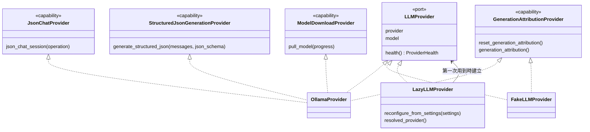
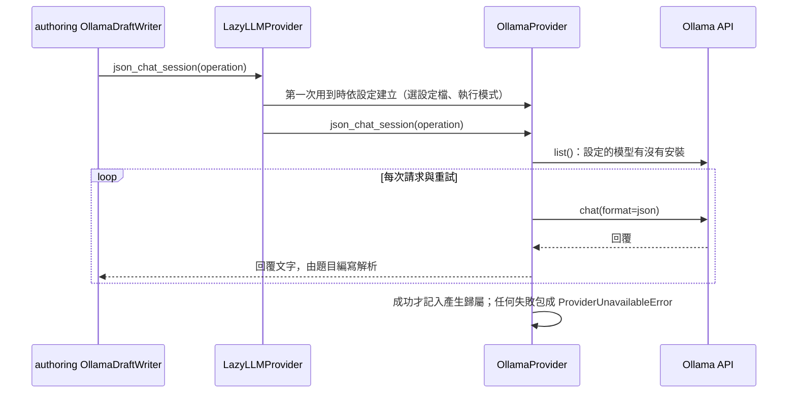

# AI 供應（AI Providers）

程式：`apps/cert-prep-backend/src/cert_prep_backend/ai_providers`。

## 負責與不負責

負責：依使用者的偏好選擇語言模型的供應者（Ollama 或假供應者）；檢查供應者與模型能不能用；為這台機器選 Ollama 模型設定檔與執行模式；盤點機器；以 JSON 模式和模型對話、產生結構化 JSON；延遲建立供應者，讓 app 啟動時不探測 Ollama。

不負責：寫題目草稿與它的 prompt（題目編寫）、錯題解說的內容（練習與複習）、擷取結果的結構化 prompt（擷取整合）、安裝 Ollama 與下載模型（執行環境）。錄音文字的繁體中文翻譯由 AI 供應實作，段落與翻譯結果由教材來源管理。

## 用語

| 中文               | 程式名稱                                   | 意思                                                           |
| ------------------ | ------------------------------------------ | -------------------------------------------------------------- |
| 供應者             | `LLMProvider`                              | 使用者設定的語言模型：哪個供應者、哪個模型、目前能不能用       |
| 供應者健康狀態     | `ProviderHealth`                           | 供應者與模型是否可用、為什麼不能用、用哪個設定檔與執行模式；Ollama 時包含實際載入的裝置 |
| 供應者能力         | `provider_capability`                      | 供應者除了回報健康之外能做的事；延遲建立的供應者在查詢時才建立 |
| JSON 對話          | `JsonChatProvider`、`JsonChat`             | 以 JSON 模式和設定的模型對話；一個工作階段內模型只檢查一次     |
| 結構化 JSON        | `StructuredJsonGenerationProvider`         | 依 JSON schema 產生一個候選結果，原樣回傳不修正                |
| 模型下載           | `ModelDownloadProvider`                    | 使用者確認後下載設定的模型                                     |
| 模型上線檢查       | `ModelOnboardingProvider`                  | 下載前檢查執行環境、下載後確認模型能回應                       |
| 產生歸屬           | `GenerationAttributionProvider`            | 最近一次成功的產生實際用了哪個供應者與模型                     |
| 釋放資源           | `ResourceReleasingProvider`                | 串流產生工作結束後讓模型卸載                                   |
| 串流參數           | `StreamingGenerationOptionsProvider`       | 串流產生時供應者自己的呼叫參數，例如用完就卸載模型             |
| 產生時才啟動       | `StartsOnGenerationProvider`               | 產生時才啟動還沒執行的供應者執行環境                           |
| 需要安裝的執行環境 | `RuntimeInstallationProvider`              | 供應者需要在本機安裝的執行環境（Ollama）                       |
| 延遲建立的供應者   | `LazyLLMProvider`                          | 第一次用到時才依設定建立的供應者                               |
| 供應者偏好         | `LLMProviderPreference`                    | 使用者設定的偏好：自動、Ollama 或假供應者                      |
| 供應者選擇         | `LLMProviderSelection`、`select_provider`  | 偏好選中的供應者、實際使用的供應者，以及它需要安裝什麼         |
| 執行模式           | `LLMExecutionMode`                         | 模型用加速器（自動）或只用 CPU                                 |
| 模型設定檔         | `OllamaModelProfile`                       | 一個 Ollama 模型與它的參數、需要的記憶體與磁碟空間             |
| 設定檔選擇         | `OllamaProfileSelection`                   | 為這台機器選中的設定檔、備用設定檔與原因                       |
| 機器盤點           | `MachineInventory`、`MachineInventoryRead` | CPU、記憶體、儲存空間與加速器；用來選設定檔與執行模式          |
| Ollama 伺服器歸屬  | `OllamaServerOwnership`                    | 健康檢查看到誰在跑 Ollama：owned、external、not_running        |
| 裝置目標           | `DeviceTarget`                             | 政策要求的執行目標：dedicated_gpu、integrated_gpu、cpu、unmanaged |
| 裝置後端           | `DeviceBackend`                            | cuda、rocm、vulkan、cpu；日誌裡的 CUDA0 等標籤會正規化成這四個 |
| 裝置驗證           | `DeviceVerification`                       | pending、verified、mismatch、unknown、not_observable           |
| 要求的裝置         | `RequestedDevice`                          | 健康檢查回報的目標、後端與顯示卡名稱                           |
| 觀察到的裝置       | `ObservedDevice`                           | 伺服器日誌裡的後端、顯示卡名稱與卸載層數                       |
| Ollama 裝置狀態    | `OllamaDeviceStatus`                       | 一次 Ollama 健康檢查的伺服器歸屬、要求、驗證、觀察與矯正重啟次數 |
| 裝置偏好           | `DevicePreference`                         | 存下來的 Ollama 裝置選擇；沒有資料列就是自動                   |
| 裝置偏好模式       | `DevicePreferenceMode`                     | auto、cpu、adapter                                             |
| 裝置偏好狀態       | `DevicePreferenceStatus`                   | active、pending、external_server、adapter_missing、not_applicable |
| 裝置偏好被拒       | `DevicePreferenceRejected`                 | 這台機器不能儲存這個選擇，例如顯示卡不在可選清單裡             |
| 可選顯示卡         | `selectable_adapters`                      | 目前盤點裡可列出的實體顯示卡、分類、政策會用的後端，以及能不能選 |

## 聚合與不變條件

- 供應者一定能回報健康狀態；其他能力都是選用的，以 `provider_capability` 查詢。延遲建立的供應者只轉發能力，查詢時才建立真正的供應者。
- Ollama 的健康狀態帶著實際載入的裝置：伺服器歸屬、要求的目標、驗證結果，以及日誌裡看得到的後端與顯示卡。不是 Ollama 時裝置是空的。單調時鐘與英文驗證說明留在 Ollama 套件，不進 API。
- 偏好是假供應者時才選假供應者；自動與 Ollama 都選 Ollama。選中 Ollama 時，它需要安裝 Ollama 與模型。
- JSON 對話的工作階段：開始前檢查一次模型；裡面任何失敗，包括讀回覆時的失敗，都當作模型呼叫失敗（「Ollama unavailable for configured model …」）；只有成功的工作階段記入產生歸屬。
- 只有供應者是 Ollama、而且設定檔啟用時才選設定檔；只有在選設定檔時才盤點機器。盤點結果保留 5 分鐘，要求重新盤點時才再量一次。
- 供應者不寫題目草稿：題目編寫用 JSON 對話自己寫（D14）。

## 用例

| 用例             | 程式名稱                  | 說明                                                   |
| ---------------- | ------------------------- | ------------------------------------------------------ |
| 檢查供應者       | `check_provider_health`   | 供應者與模型能不能用；Ollama 沒在執行時會先嘗試啟動它。Ollama 回報實際載入的裝置；不是 Ollama 時裝置是空的 |
| 查看供應者選擇   | `show_provider_selection` | 偏好選中的供應者，以及實際使用的供應者與模型           |
| 列出模型設定檔   | `list_model_profiles`     | 可以選的 Ollama 模型設定檔                             |
| 查看設定檔選擇   | `show_profile_selection`  | 為這台機器選中的設定檔；不適用時改用設定的模型         |
| 盤點機器         | `inspect_machine`         | 這台機器的 CPU、記憶體、儲存空間與加速器               |
| 選 Ollama 設定檔 | `choose_ollama_profile`   | 依設定與機器選設定檔；建立供應者與安裝設定檔模型時使用 |
| 查看裝置偏好     | `show_device_preference`  | 存下來的裝置選擇、目前是否生效，以及這台機器列得出的顯示卡 |
| 選擇裝置偏好     | `choose_device_preference` | 存下自動、CPU 或一塊目前可選的顯示卡，請伺服器切換，不等重啟 |

## 主要流程

`create_app` 把 `lazy_provider_from_settings(settings)`（測試可以注入自己的供應者）放在 `app.state.llm_provider`，把 `OllamaMachineInventory(settings)` 放在 `app.state.machine_inventory`，並交給執行環境的 `RuntimeInstallationManager`。router 只呼叫 `application/use_cases.py` 的用例。

## 與其他上下文的關係

- 題目編寫：用 `draft_writer_for` 為設定的供應者挑選寫草稿者，Ollama 經 JSON 對話寫草稿；串流產生使用串流參數、產生歸屬與釋放資源。
- 練習與複習：用供應者的健康狀態決定能不能請模型解說錯題；解說能力 `PracticeExplanationProvider` 由練習與複習自己定義。
- 擷取整合：用結構化 JSON 整理擷取結果。
- 執行環境：用模型下載、模型上線檢查與需要安裝的執行環境安裝 Ollama 與模型；安裝設定檔模型時用 `choose_ollama_profile`；`/runtime/machine-inventory` 用 `inspect_machine`，回應用 AI 供應的 `MachineInventoryRead`（已知例外，D15）。`/llm/model-downloads` 是執行環境的端點（D14）。
- 教材來源：`infrastructure/translation.py` 的 `OllamaTraditionalChineseTranslator` 實作教材來源的 `TraditionalChineseTranslator` port，由 `bootstrap/source_library_links.py` 接線。使用設定的主機、模型與逾時；單段翻譯用完即卸載，批次翻譯保留模型 5 分鐘，結束時釋放資源。每個翻譯請求算一次使用擁有的伺服器，裝置切換會等它；使用者選 CPU 時加上 `num_gpu=0`。其餘提示詞、呼叫參數與錯誤維持原樣，沒有另外包裝翻譯用例。

其他上下文只能經 `ai_providers.application` 與 `ai_providers.domain` 使用 AI 供應（import-linter「Other contexts reach AI Providers only through its application and domain」），AI 供應不依賴任何其他上下文（「AI Providers does not depend on other contexts」）。

## 規則與資料來源

- 設定：`CERT_PREP_LLM_PROVIDER`（`auto`、`ollama`、`fake`）、`CERT_PREP_OLLAMA_HOST`、`CERT_PREP_OLLAMA_MODEL`、`CERT_PREP_OLLAMA_PROFILE_ENABLED`、`CERT_PREP_OLLAMA_PROFILE_ID`、`CERT_PREP_OLLAMA_PROFILE_INVENTORY_TIMEOUT_SECONDS`（`platform/config.py`）。
- 設定檔目錄、選設定檔與執行模式的規則：`packages/cert-prep-ollama`（`cert_prep_ollama.profiles`）；機器盤點：`cert_prep_ollama.inventory`。
- HTTP：`/llm/health`、`/llm/provider-selection`、`/llm/profiles`、`/llm/profile-selection`、`GET /llm/device-preference`、`PUT /llm/device-preference`（DTO 在 `ai_providers/api/schemas.py`）。
- 資料表：`ollama_device_preference`（遷移 29，單列）。沒有資料列就是自動。選擇顯示卡時一併存名稱與 PCI 識別，供顯示卡換插槽後對回。
- 查看與選擇裝置偏好是應用層用例；router 只做對應。`GET` 用快取的機器盤點；`PUT` 也先用快取，只有要求的顯示卡不在快取清單裡才重新盤點一次。`PUT` 回傳寫入後讀回的資料列。它把選擇交給協調器就回傳，不做 I/O、不拿生命週期的鎖、不等停止或啟動：擁有的伺服器跑的是別的選擇，或已經有切換在進行時，回 `pending`；伺服器已經跑這個選擇時，什麼都不做。
- 健康檢查的 `device` 與 `GET /llm/device-preference` 讀一份狀態快照，只用一個小鎖，從不等切換、矯正重啟或 `ensure_running` 的啟動。切換等待或進行時，`device.requested` 還是正在跑的伺服器的政策，新伺服器啟動時才換成新選擇，並重新計算它自己的一次矯正重啟。
- 使用擁有的伺服器的工作分兩類，都只登記計數、不握住鎖。短工作：產生與翻譯。長工作：模型下載、設定檔的下載與建立。切換不會中斷任何一類。切換在等待、而且沒有長工作時，新的呼叫（兩類都算）先等，進行中的短工作做完就切換，所以接連不斷的呼叫也不會讓切換一直等下去。有長工作時新的呼叫照常進行，不讓下載卡住產生；最後一個長工作結束後才開始擋。最後一個工作結束時（成功或失敗都算）喚醒切換執行緒。
- 切換由協調器自己的背景執行緒做，一次只做一個。它讀存下的選擇，停掉舊伺服器，用最新的選擇啟動；讀選擇與盤點時不拿鎖。切換中又存了新的選擇時，新伺服器就緒後若存的選擇已不同，再換一次；相同就不再重啟。切換不用矯正重啟的 30 秒期限；等待或進行切換時完成的那次載入用的是舊伺服器，所以不驗證。
- 矯正重啟對短工作照舊：最多等 30 秒。發現不符時若有長工作，不重啟也不擋新的呼叫，驗證維持 `pending`，下一次載入模型時再判斷。
- 啟動失敗時狀態維持 `pending`，健康檢查的 `device.server` 是 `not_running`。切換執行緒不重試；下一次啟動伺服器（健康檢查發現 API 沒有回應時的 `ensure_running`）用最新的選擇啟動。在那之前再送選擇，不會啟動伺服器，狀態仍是 `pending`。停止失敗時舊伺服器繼續服務，之後的呼叫不被擋，也不在每次載入後重試；等它不再回應時由 `ensure_running` 停掉並啟動新選擇。停止進行中存下的新選擇不會遺失，之後照常切換。切換執行緒裡意外的錯誤只記錄；擋住呼叫的旗標一定清掉，執行緒繼續處理之後的選擇。新伺服器已經起來後讀不到存下的選擇，不算切換失敗：伺服器繼續服務；啟動期間若存了更新的選擇，那個選擇維持 `pending`，等下一次選擇或下一次啟動。關閉時切換執行緒停不掉它啟動的伺服器，`close()` 會再停一次。
- 關閉時，還沒開始的切換直接取消。正在停止或啟動的切換在步驟之間看到關閉，停掉它啟動的伺服器並結束；關閉最多等它兩次停止程序的時間（不等 30 秒的就緒等待），之後再停掉協調器仍記得的程序，所以直譯器隨即結束也不會留下 `ollama serve`。
- 外部伺服器只儲存、不重設。使用者選 CPU 時，`execution_mode` 是 `cpu`，警告寫出是使用者的選擇，每個產生與翻譯請求都帶 `num_gpu=0`（每次呼叫時決定）；外部 Ollama 也送 `num_gpu=0`，但不重啟。機器上沒有 GPU 而且選自動時，仍用建立供應者當下的執行政策與原來的警告，翻譯請求也和以前一樣。
- API 的 `LLMExecutionMode`、`LLMProviderName`、`LLMProviderPreference`、`OllamaServerOwnership`、`DeviceTarget`、`DeviceBackend`、`DeviceVerification`、`DevicePreferenceMode`、`DevicePreferenceStatus` 列舉值對應到概念集的 `ai-providers.*`；`RuntimeRequirementKind` 對應到 `runtime-provisioning.*`。
