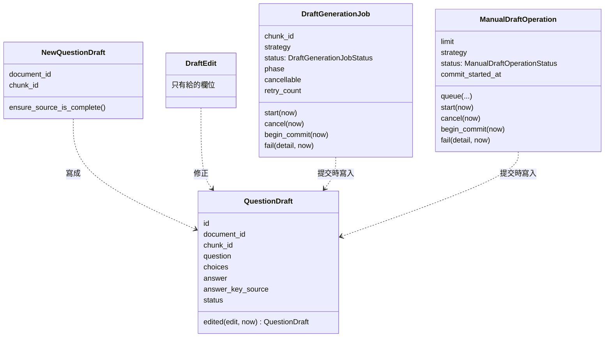
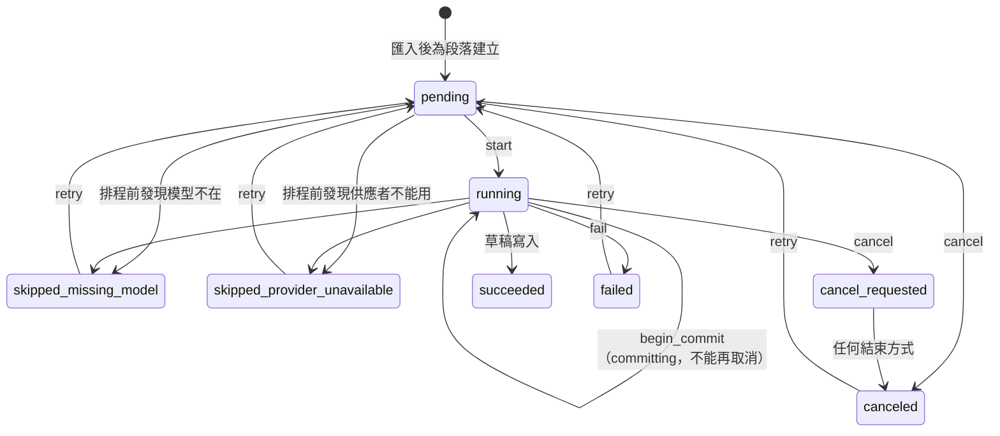
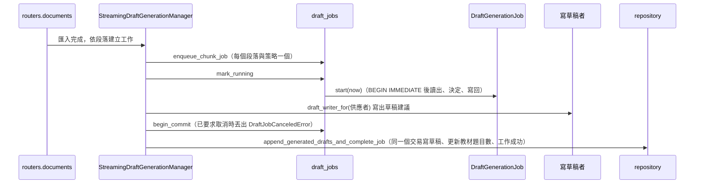

# 題目編寫（Question Authoring）

程式：`apps/cert-prep-backend/src/cert_prep_backend/authoring`。

## 負責與不負責

負責：題目草稿的手寫、編修與列出；由教材段落產生草稿（先做確定性解析，再請語言模型補上答案與解說、或找出解析不到的題目）；匯入教材後為每個段落產生題目的背景工作、學習者要求為整份教材產生題目的作業，以及它們的取消、重試與重新開機後的復原。

不負責：教材與段落本身（教材來源）、選擇與呼叫語言模型（AI 供應）、練習與作答（練習與複習）、擷取結果的檢閱（擷取整合）。

## 用語

| 中文             | 程式名稱                      | 意思                                                            |
| ---------------- | ----------------------------- | --------------------------------------------------------------- |
| 題目草稿         | `QuestionDraft`               | 由段落產生或手動建立、可以編修的選擇題                          |
| 手寫草稿         | `NewQuestionDraft`            | 學習者自己寫的題目；引用出處時教材與段落要一起給                |
| 草稿編修         | `DraftEdit`                   | 學習者對草稿的修正；只改有給的欄位，出處與狀態不變              |
| 草稿狀態         | `DraftStatus`                 | 草稿是否已核可；產生與手寫的草稿都直接核可                      |
| 答案來源         | `AnswerKeySource`             | 答案由學習者給、教材上的答案，或模型推論                        |
| 草稿來源段落     | `SourceChunk`                 | 交給寫草稿者的一段教材文字、頁碼與內容類型                      |
| 草稿建議         | `DraftSuggestion`             | 寫草稿者寫出、還沒存成草稿的一題                                |
| 待檢查的解析題   | `UnavailableDraftBlock`       | 解析到但沒能補完答案的題目，保留下來讓學習者檢查                |
| 產生結果         | `DraftGenerationResult`       | 一次產生得到的草稿建議與待檢查的解析題                          |
| 產生策略         | `DraftGenerationStrategy`     | 只用確定性解析，或解析加上語言模型                              |
| 寫草稿者         | `DraftGenerationProvider`     | 把段落寫成題目草稿的介面；`draft_writer_for` 依設定的供應者挑選 |
| 推理寫草稿       | `ReasoningDraftProvider`      | 請模型從段落找出完整的選擇題                                    |
| 快速首題         | `FastFirstDraftProvider`      | 請模型為一題解析到的題目補上答案與解說                          |
| Ollama 寫草稿者  | `OllamaDraftWriter`           | 經 JSON 對話請 Ollama 補答案與解說、或找出解析不到的題目        |
| 佔位草稿寫草稿者 | `PlaceholderDraftWriter`      | 假供應者用的固定草稿，讓 app 與測試不需要模型也能跑             |
| 產生工作         | `DraftGenerationJob`          | 匯入教材後，為一個段落產生題目的背景工作（每個段落與策略一個）  |
| 產生工作狀態     | `DraftGenerationJobStatus`    | 等待、執行中、要求取消、已取消、成功、因模型或供應者跳過、失敗  |
| 手動產生作業     | `ManualDraftOperation`        | 學習者要求為整份教材產生題目；同一份教材同時只有一個進行中      |
| 手動產生作業狀態 | `ManualDraftOperationStatus`  | 排隊、執行中、要求取消、已取消、成功、失敗                      |
| 產生已取消       | `DraftJobCanceledError`       | 取消在開始提交前發生；產生的草稿不寫入                          |
| 產生不能取消     | `DraftJobNotCancellableError` | 已經開始提交草稿，不能再取消                                    |

## 聚合與不變條件

- 手寫草稿引用出處時，教材與段落要一起給，段落必須屬於這份教材；檢查順序是專案、出處成對、段落存在。
- 編修只改有給的欄位：空字串會清空，沒給或給 `null` 的不變；出處、狀態與建立時間不變。
- 產生的草稿與這份教材同一段落裡的草稿題號相同，或題目（忽略大小寫與前後空白，由 SQLite 比較）相同時，視為重複、不再寫入。
- 每個段落與策略只有一個產生工作；同一份教材同時只有一個進行中的手動產生作業。
- 開始提交前都能取消；開始提交後不能取消。要求取消後，任何結束方式都記為已取消；提交時發現已要求取消會丟出 `DraftJobCanceledError`，由執行的一方記為已取消。
- 只有失敗會計入重試次數；因模型或供應者跳過、失敗或取消的工作可以重試。
- 重新開機時，執行中的工作回到等待、手動作業回到排隊，要求取消的記為已取消，段落已被刪除的工作記為失敗。
- 草稿寫入與工作（或作業）成功在同一個交易；每次狀態轉換在鎖定後讀出、由聚合決定、以原狀態為條件寫回。

## 用例

| 用例           | 程式名稱                   | 說明                                                         |
| -------------- | -------------------------- | ------------------------------------------------------------ |
| 列出草稿       | `list_drafts`              | 專案的所有題目草稿，新的在前                                 |
| 手寫草稿       | `write_draft`              | 寫一題草稿，可以引用一份教材的一個段落                       |
| 編修草稿       | `edit_draft`               | 修正草稿；只改有給的欄位                                     |
| 為教材產生草稿 | `generate_document_drafts` | 立即用整份教材的段落產生草稿，略過重複的，並記錄教材的題目數 |
| 列出產生工作   | `list_generation_jobs`     | 教材各段落的產生工作與狀態                                   |
| 重試產生工作   | `retry_generation_jobs`    | 讓因模型或供應者跳過、失敗或取消的工作重新排隊並執行         |
| 取消產生工作   | `cancel_generation_job`    | 等待中的工作立即取消，執行中的要求停止；開始提交後不能取消   |
| 開始手動產生   | `start_manual_generation`  | 在背景為整份教材產生草稿；已有進行中的作業時回傳那一個       |
| 查看手動產生   | `view_manual_generation`   | 一個手動產生作業的狀態、產生數量與待檢查的解析題             |
| 取消手動產生   | `cancel_manual_generation` | 排隊中的作業立即取消，執行中的要求停止；提交後不能取消       |

匯入教材時自動產生草稿的流程仍在 `routers/documents.py`，C6 把擷取規則移出 router 時才移入這裡的用例。

## 主要流程

`create_app` 建立 `SqliteQuestionDraftRepository`、`SqliteDraftGenerationJobRepository`、`StreamingDraftGenerationWork`、`SourceLibraryDraftSources`、`ProviderDraftWriting`，放在 `app.state.question_draft_repository`、`draft_generation_job_repository`、`draft_generation_work`、`draft_sources`、`draft_writing`；router 只依 `application/ports.py` 的 port 呼叫用例。

## 與其他上下文的關係

- 教材來源：為教材產生草稿時，經 `source_library.application` 的 `list_chunks` 與 `view_document` 讀段落與教材；更新教材的題目數、背景產生讀段落與更新教材狀態仍直接呼叫教材來源的儲存函式（已知例外，C5 資料表歸屬改經教材來源的用例）。
- AI 供應：`draft_writer_for` 依設定的供應者挑選寫草稿者；Ollama 經 JSON 對話寫草稿；串流產生使用串流參數、產生歸屬與釋放資源（見 [ai_providers.md](ai_providers.md)）。
- 學習專案：確認專案存在仍直接呼叫 `projects.infrastructure`（已知例外，C5）。
- 練習與複習：練習只出已核可的草稿；它直接讀 `question_drafts` 資料表（C5）。
- 擷取整合與教材匯入：匯入教材時的自動產生由 `routers/documents.py` 驅動（C6）。

題目編寫不依賴擷取整合、練習與複習、執行環境（import-linter「Question Authoring does not depend on its downstream contexts」）。

## 規則與資料來源

- 資料表：`question_drafts`、`draft_generation_jobs`、`manual_draft_generation_operations`；migration 在 `platform/database.py`。
- 確定性解析：`domain/deterministic_parser.py` 與教材來源的 `exam_content`。
- HTTP：`/projects/{project_id}/question-drafts`、`/projects/{project_id}/documents/{document_id}/drafts`、`…/draft-jobs`、`…/draft-operations`（DTO 在 `authoring/api/schemas.py`）；產生工作與手動作業的即時狀態經 `routers/operation_events.py` 的 server-sent events。
- API 的 `DraftStatus`、`AnswerKeySource`、`DraftGenerationStrategy`、`DraftGenerationJobStatus`、`ManualDraftOperationStatus` 列舉值對應到概念集的 `authoring.*`。
