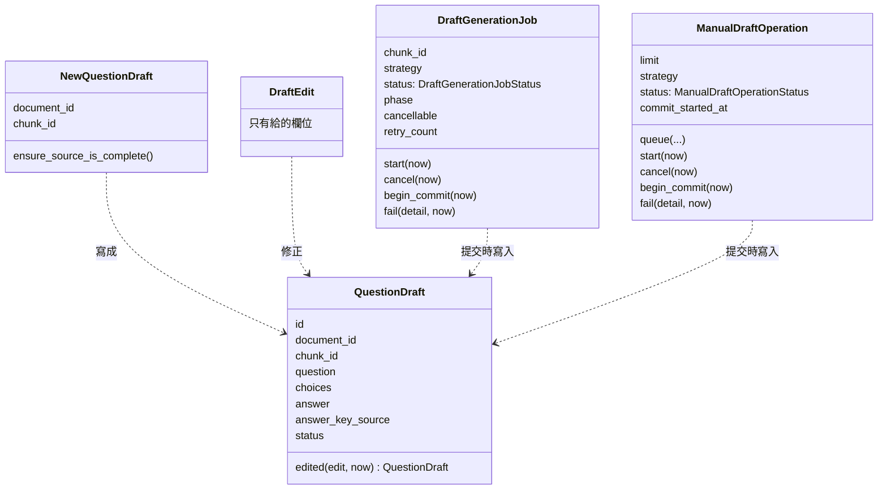
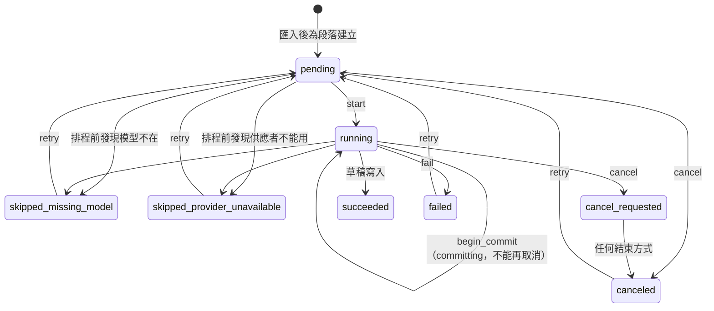
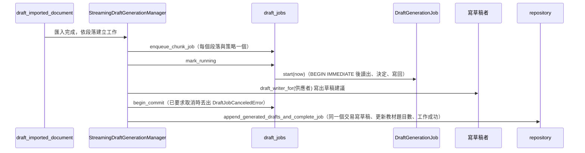
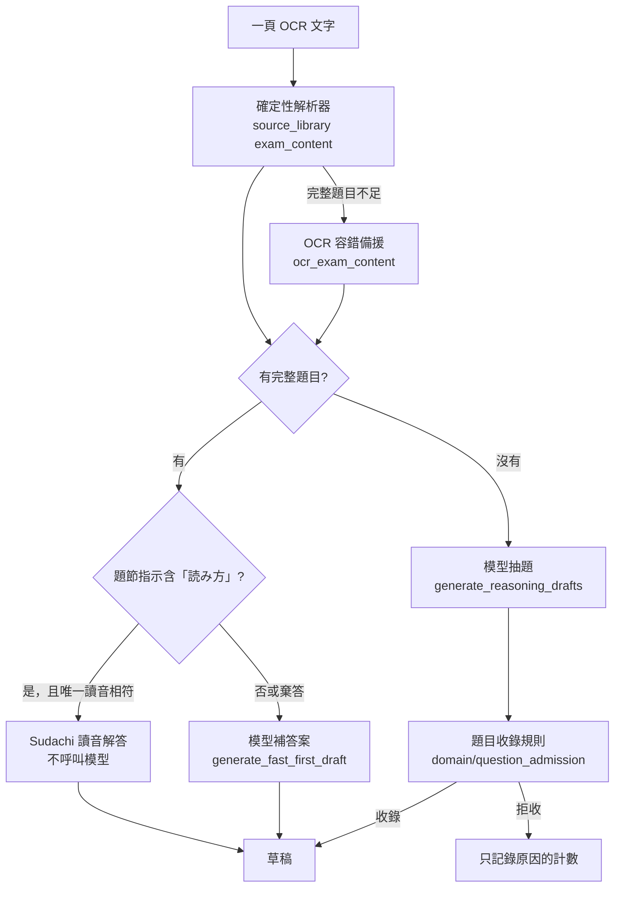

# 題目編寫（Question Authoring）

程式：`apps/cert-prep-backend/src/cert_prep_backend/authoring`。

## 負責與不負責

負責：題目草稿的手寫、編修與列出；由教材段落產生草稿（先做確定性解析，再請語言模型補上答案與解說、或找出解析不到的題目）；匯入教材後為每個段落產生題目的背景工作、學習者要求為整份教材產生題目的作業，以及它們的取消、重試與重新開機後的復原。

不負責：教材與段落本身（教材來源）、選擇與呼叫語言模型（AI 供應）、練習與作答（練習與複習）、擷取結果的檢閱（擷取整合）。

## 用語

| 中文             | 程式名稱                      | 意思                                                            |
| ---------------- | ----------------------------- | --------------------------------------------------------------- |
| 題目草稿         | `QuestionDraft`               | 由段落產生或手動建立、可以編修的選擇題                          |
| 手寫草稿         | `NewQuestionDraft`            | 學習者自己寫的題目；引用出處時教材與段落要一起給                |
| 草稿編修         | `DraftEdit`                   | 學習者對草稿的修正；只改有給的欄位，出處與狀態不變              |
| 草稿狀態         | `DraftStatus`                 | 草稿是否已核可；產生與手寫的草稿都直接核可                      |
| 答案來源         | `AnswerKeySource`             | 答案由學習者給、教材上的答案，或模型推論                        |
| 草稿來源段落     | `SourceChunk`                 | 交給寫草稿者的一段教材文字、頁碼與內容類型                      |
| 草稿建議         | `DraftSuggestion`             | 寫草稿者寫出、還沒存成草稿的一題                                |
| 待檢查的解析題   | `UnavailableDraftBlock`       | 解析到但沒能補完答案的題目，保留下來讓學習者檢查                |
| 產生結果         | `DraftGenerationResult`       | 一次產生得到的草稿建議與待檢查的解析題                          |
| 產生策略         | `DraftGenerationStrategy`     | 只用確定性解析，或解析加上語言模型                              |
| 寫草稿者         | `DraftGenerationProvider`     | 把段落寫成題目草稿的介面；`draft_writer_for` 依設定的供應者挑選 |
| 推理寫草稿       | `ReasoningDraftProvider`      | 請模型從段落找出完整的選擇題                                    |
| 快速首題         | `FastFirstDraftProvider`      | 請模型為一題解析到的題目補上答案與解說                          |
| 漢字讀音片段     | `ReadingSpan`                 | 詞典提供的原文片段與讀音                                        |
| 讀音解答         | `ReadingSolution`             | 唯一符合的選項索引、原文片段、平假名讀音與固定解說              |
| 讀音詞典         | `ReadingLexicon`              | 提供題幹內含漢字片段讀音的 application port                     |
| 抽出題目         | `ExtractedQuestion`           | 模型從原文頁面抽出的題幹與選項，連同該頁原文，等待收錄判斷      |
| 題目收錄         | `QuestionAdmission`           | 一題抽出題目的收錄結果：清理後的題幹，或拒收原因                |
| 拒收原因         | `AdmissionRejection`          | 抽出題目未被收錄的原因代碼；只記錄與量測，不進 API              |
| Ollama 寫草稿者  | `OllamaDraftWriter`           | 經 JSON 對話請 Ollama 補答案與解說、或找出解析不到的題目        |
| 佔位草稿寫草稿者 | `PlaceholderDraftWriter`      | 假供應者用的固定草稿，讓 app 與測試不需要模型也能跑             |
| 產生工作         | `DraftGenerationJob`          | 匯入教材後，為一個段落產生題目的背景工作（每個段落與策略一個）  |
| 產生工作狀態     | `DraftGenerationJobStatus`    | 等待、執行中、要求取消、已取消、成功、因模型或供應者跳過、失敗  |
| 手動產生作業     | `ManualDraftOperation`        | 學習者要求為整份教材產生題目；同一份教材同時只有一個進行中      |
| 手動產生作業狀態 | `ManualDraftOperationStatus`  | 排隊、執行中、要求取消、已取消、成功、失敗                      |
| 產生已取消       | `DraftJobCanceledError`       | 取消在開始提交前發生；產生的草稿不寫入                          |
| 產生不能取消     | `DraftJobNotCancellableError` | 已經開始提交草稿，不能再取消                                    |

## 聚合與不變條件

- 手寫草稿引用出處時，教材與段落要一起給，段落必須屬於這份教材；檢查順序是專案、出處成對、段落存在。
- 編修只改有給的欄位：空字串會清空，沒給或給 `null` 的不變；出處、狀態與建立時間不變。
- 產生的草稿與這份教材同一段落裡的草稿題號相同，或題目（忽略大小寫與前後空白，由 SQLite 比較）相同時，視為重複、不再寫入。
- 每個段落與策略只有一個產生工作；同一份教材同時只有一個進行中的手動產生作業。
- 開始提交前都能取消；開始提交後不能取消。要求取消後，任何結束方式都記為已取消；提交時發現已要求取消會丟出 `DraftJobCanceledError`，由執行的一方記為已取消。
- 只有失敗會計入重試次數；因模型或供應者跳過、失敗或取消的工作可以重試。
- 重新開機時，執行中的工作回到等待、手動作業回到排隊，要求取消的記為已取消，段落已被刪除的工作記為失敗。
- 草稿寫入與工作（或作業）成功在同一個交易；每次狀態轉換在鎖定後讀出、由聚合決定、以原狀態為條件寫回。

## 用例

| 用例             | 程式名稱                             | 說明                                                                     |
| ---------------- | ------------------------------------ | ------------------------------------------------------------------------ |
| 列出草稿         | `list_drafts`                        | 專案的所有題目草稿，新的在前                                             |
| 已核可的題目     | `approved_questions`                 | 專案已核可的草稿，依 id；一份教材則依來源順序                            |
| 查看一題草稿     | `find_question_draft`                | 專案裡這一題目前的草稿；沒有時是 None                                    |
| 查看這些草稿     | `question_drafts_for`                | 這些 id 目前的草稿；沒有草稿的 id 不在結果裡                             |
| 手寫草稿         | `write_draft`                        | 寫一題草稿，可以引用一份教材的一個段落                                   |
| 編修草稿         | `edit_draft`                         | 修正草稿；只改有給的欄位                                                 |
| 為教材產生草稿   | `generate_document_drafts`           | 立即用整份教材的段落產生草稿，略過重複的，並記錄教材的題目數             |
| 列出產生工作     | `list_generation_jobs`               | 教材各段落的產生工作與狀態                                               |
| 重試產生工作     | `retry_generation_jobs`              | 讓因模型或供應者跳過、失敗或取消的工作重新排隊並執行                     |
| 取消產生工作     | `cancel_generation_job`              | 等待中的工作立即取消，執行中的要求停止；開始提交後不能取消               |
| 丟棄未結束的工作 | `discard_unfinished_generation_jobs` | 給教材來源：教材的處理停止或重試時，刪掉還沒結束的工作；已結束的留作紀錄 |
| 開始手動產生     | `start_manual_generation`            | 在背景為整份教材產生草稿；已有進行中的作業時回傳那一個                   |
| 查看手動產生     | `view_manual_generation`             | 一個手動產生作業的狀態、產生數量與待檢查的解析題                         |
| 取消手動產生     | `cancel_manual_generation`           | 排隊中的作業立即取消，執行中的要求停止；提交後不能取消                   |
| 匯入後起草       | `draft_imported_document`            | 匯入後有段落的教材：排入產生工作，或依設定立即寫出草稿                   |

教材來源的 `import_document` 與 `retry_document_processing` 擷取出段落後，經教材來源的 port `ImportedDocumentDrafting` 呼叫 `draft_imported_document`；實作這個 port 的是 `infrastructure/import_drafting.py` 的 `ImportedDocumentDrafts`，它依設定（`streaming_draft_generation_on_upload`、`auto_generate_exam_on_upload`、`auto_generate_exam_limit`）呼叫用例。匯入時直接產生草稿時，模型無法使用就不寫草稿；之後記錄教材的題目數，有文字與段落的教材記為可用，否則記為 `exam_failed`（`SourceDocument.status_after_import_drafts`）。

## 主要流程

提交草稿的交易以 `BEGIN IMMEDIATE` 開始：寫入草稿、數出教材的草稿數，再經 port `DocumentExamState` 請教材來源記錄題目數與教材狀態（工作用 `record_import_draft_count`，手動作業用 `record_draft_count`），最後把工作或作業標為成功。`bootstrap/authoring_links.py` 的 `bind_document_exam_state` 把這個交易的連線交給教材來源的 repository，任何一步失敗時全部復原。以前這是題目編寫自己的一個 `UPDATE documents`，草稿數在同一句裡數；現在數和寫在同一個寫入鎖裡，結果相同。

`create_app` 建立 `StreamingDraftGenerationManager`（接上 `bind_document_exam_state`、`authoring_projects` 與 `authoring_documents`）、`SqliteQuestionDraftRepository`、`SqliteDraftGenerationJobRepository`、`StreamingDraftGenerationWork`、`SourceLibraryDraftSources`、`ProviderDraftWriting`、`ImportedDocumentDrafts`，放在 `app.state.question_draft_repository`、`draft_generation_job_repository`、`draft_generation_work`、`draft_sources`、`draft_writing`、`imported_document_drafting`；題目編寫對專案與教材的檢查分別經 port `StudyProjects`、`ProjectDocuments` 與 `DraftSources`，不直接引用其他上下文的 infrastructure；router 只依 `application/ports.py` 的 port 呼叫用例。

### 漢字讀音解答

批次、手動作業與背景首題共用 `OllamaDraftWriter.generate_fast_first_draft`。候選題尚無答案，而且同段落中最近的前置題節指示含「読み方」或「よみかた」時，才用 `domain/reading_solver.py` 比對讀音；沒有指示、其他題型或棄答均沿用既有 JSON 對話。題節指示以內部 `section_instruction` 傳遞，不寫入序列化、HTTP 或資料表，不借用前一段落的指示，也不改變既有題組資訊；模型預檢的時機不變。設定 `reading_solver_enabled` 預設開啟，可用 `CERT_PREP_READING_SOLVER_ENABLED=false` 關閉。

`SudachiReadingLexicon` 實作 application 的 `ReadingLexicon`，以 core 詞典的 A、C 分詞模式，列舉每個含漢字（含「々」）的 1–4 token 連續片段。讀音只取單一詞素或 `Dictionary.lookup` 中原文完全相同的完整詞條，不拼接多個詞素的讀音。數詞也棄答：core 詞典即使將「三百」視為一個詞素，仍會提供未處理音變的讀音。單一 adapter 在首次使用時載入 tokenizer，鎖定至片段完全物化，供批次與背景工作共用；套件、詞典載入或分詞失敗只記錄一次警告，之後回傳空片段以沿用模型。

純規則去掉選項的半形／全形數字前綴與空白（含 U+3000），並將片假名轉成平假名。任一選項正規化後少於兩字、沒有選項匹配，或多個選項匹配時均棄答；多個片段符合同一選項仍算唯一解，依原文與讀音排序以固定解說。不依賴 PDF 底線或指定的目標詞。

成功時保留候選題的原始選項與來源資訊，答案直接使用該選項的完整文字、信心為 1.0，解說為 `「{surface}」的讀音是「{reading}」，所以答案是 {n}。`。答案來源仍是 `ai_inferred`，學習者可沿用既有的標示與修正。`dictionary_generated` 只在內部草稿建議傳遞，不進入序列化、HTTP 或資料表；純字典結果的工作／作業 `effective_provider`、`effective_model` 留空，混合結果保留實際模型歸屬。

### PDF 匯入的出題順序（混合策略）

前端「產生題目」與上傳後的背景產生都預設 `hybrid_reasoning`。PDF 的文字一律來自 Capture Runtime 的 OCR（PDFium 轉圖、PaddleOCR 辨識，沒有內嵌文字層捷徑），所以每一步都要容忍 OCR 錯誤。每一頁依下列順序處理：

- 解析器：確定性解析器是主路徑，行為固定；只有某頁完整題目不足時才改用 `source_library/domain/ocr_exam_content.py` 的容錯備援，且備援必須抽得更多、又不能丟掉主路徑的合理題目（見該模組說明）。
- 有完整題目的頁面只補答案；沒有完整題目的頁面才交給模型抽題，且每頁只交一次（`draft_writing.py`、`streaming.py`）。模型抽出的草稿依頁碼與頁內順序取得 `source_order`，練習順序與原卷一致。
- 抽題提示詞列出解析器讀取的確切鍵名；`qwen3.5:9b` 仍常回 `question_stem`，所以解析器同時接受 `question`、`question_stem`、`stem`。

### 題目收錄規則

模型抽出的每一題依序檢查，第一個不通過的檢查就是拒收原因（`AdmissionRejection`）。前半是模型 JSON 的結構檢查（`infrastructure/reasoning_parser.py`），後半是內容規則（`domain/question_admission.py`）。

| 順序 | 原因代碼                | 規則                                                                                  | 為什麼需要                                                 |
| ---- | ----------------------- | ------------------------------------------------------------------------------------- | ---------------------------------------------------------- |
| 1    | `incomplete_item`       | 要有題幹、至少兩個選項與答案                                                          | 模型偶爾回傳空項目                                         |
| 2    | `invalid_confidence`    | 信心值要是 0–1 的數字                                                                 | 結構檢查                                                   |
| 3    | `unresolved_source`     | `chunk_id` 或 `citation_page`（接受 `8`、`"8"`、`"page-8"`、`8.0`）要對到提示中的頁面 | 模型以 `"page-8"` 標頁；`null` 頁碼改依 `chunk_id`         |
| 4    | `listening_page`        | 原文為紙本聽力頁（「聴解／聽解」，或「問題用紙」與「聞いて」）時拒收                  | 聽力題本只印選項，沒有音檔無法作答                         |
| 5    | `choices_only`          | 題幹尾端若含本題兩個以上選項就切掉；切完為空則拒收                                    | 模型常把選項抄進題幹                                       |
| 6    | `section_instruction`   | 含「1・2・3・4」列舉，或以「次の」開頭並要求選擇者拒收                                | 模型把大題指示當題幹；引用「選んでください」的真題不受影響 |
| 7    | `stem_is_a_choice`      | 題幹（去除句讀）等於或包含在某選項中時拒收                                            | 文章文法頁只有片段，模型以選項充當題幹                     |
| 8    | `stem_not_in_source`    | 考試頁面上，題幹至少 60% 的字元（三字以上連續片段）要出現在原文                       | 擋下模型改寫、翻譯或捏造的題幹                             |
| 9    | `answer_not_in_choices` | 答案（可為選項文字、編號或 A–D 字母）要對到選項                                       | 結構檢查                                                   |
| 10   | `excerpt_not_in_source` | 原文摘錄要能在頁面中找到（忽略空白）                                                  | 確保出處可追溯                                             |
| 11   | `not_an_exam_item`      | 排除版本說明、著作權等非題目文字                                                      | 既有規則                                                   |

量測依據（2026-10-30，`qwen3.5:9b`、RTX 4060、三份 N1 題本、210 題標準答案）：修正抽題前，混合策略找回 40 題、答對 33 題；開放未解析頁抽題後找回 55 題、答對 46 題，但模型抽出的 65 題中有 50 題對不到標準題目。以記錄的這 65 題重算，收錄規則保留全部 15 題正確抽題、拒收 35 題（聽力頁 17、題幹就是選項 8、大題指示 6、題幹不在原文 4），另有約 7 題在切除黏著選項後與標準題目完全相同。

已知限制：句子重組題抽出的題幹缺少「＿＿ ★ ＿＿」空格；同頁偶有題幹與選項配錯；閱讀題題幹可能黏著下一篇文章。這些仍會收錄，需要學習者以既有的標示與修正處理。

診斷：每次抽題後記錄一行 `Reasoning extraction admitted N of M items; rejected by reason: {...}`，只含計數，不含題目或原文。新增規則時，在 `domain/question_admission.py` 加原因代碼與判斷、在 `tests/unit/authoring/test_question_admission.py` 加測試，並更新此表；先以記錄的抽題結果重算前後差異再上線。

## 與其他上下文的關係

- 教材來源：為教材產生草稿時，經 `source_library.application` 的 `list_chunks` 與 `view_document` 讀段落與教材。背景工作與手動作業提交草稿時，經 port `DocumentExamState` 在同一個交易裡呼叫教材來源的 `record_import_draft_count`、`record_draft_count`。`SourceLibraryDraftSources` 更新題目數與背景產生讀段落仍直接呼叫教材來源的儲存函式（已知例外，C5 第三部分改經教材來源的用例：https://github.com/gx-capture/capture-workbench/issues/200）。
- 教材來源：教材的作業失敗、取消或重試時，教材來源經它的 port `DocumentDraftJobs` 呼叫 `discard_unfinished_generation_jobs`；`bootstrap/source_library_links.py` 把作業交易的連線交給 `SqliteDraftGenerationJobRepository`，工作和教材的重設一起寫入或一起復原。
- AI 供應：`draft_writer_for` 依設定的供應者挑選寫草稿者；Ollama 經 JSON 對話寫草稿；串流產生使用串流參數、產生歸屬與釋放資源（見 [ai_providers.md](ai_providers.md)）。
- 學習專案：確認專案存在仍直接呼叫 `projects.infrastructure`（已知例外，C5 處理）。
- 練習與複習：練習經自己的 port `PracticeQuestions` 呼叫 `approved_questions`、`find_question_draft`、`question_drafts_for`。實作把練習交易的連線交給 `SqliteQuestionDraftRepository`，所以讀到的是這次交易裡的草稿。
- 教材匯入：教材來源匯入或重試教材、擷取出段落後，經它的 port `ImportedDocumentDrafting` 呼叫 `draft_imported_document`；題目編寫實作這個 port，教材來源不依賴題目編寫。

題目編寫不依賴擷取整合、練習與複習、執行環境（import-linter「Question Authoring does not depend on its downstream contexts」）。

## 規則與資料來源

- 資料表：`question_drafts`、`draft_generation_jobs`、`manual_draft_generation_operations` 屬題目編寫；migration 在 `platform/database.py`。題目編寫的 SQL 不再寫 `documents` 或讀 `document_chunks`。
- 確定性解析：`domain/deterministic_parser.py` 與教材來源的 `exam_content`。
- HTTP：`/projects/{project_id}/question-drafts`、`/projects/{project_id}/documents/{document_id}/drafts`、`…/draft-jobs`、`…/draft-operations`（DTO 在 `authoring/api/schemas.py`）；產生工作與手動作業的即時狀態經 `authoring/api/operation_events.py` 的 server-sent events（`…/draft-jobs/events`、`…/draft-operations/{operation_id}/events`）；串流與心跳由 `platform/sse.py` 提供，快照來自 `list_generation_jobs` 與 `view_manual_generation`，所有工作都結束時（`all_jobs_ended`）或作業結束時串流結束。
- API 的 `DraftStatus`、`AnswerKeySource`、`DraftGenerationStrategy`、`DraftGenerationJobStatus`、`ManualDraftOperationStatus` 列舉值對應到概念集的 `authoring.*`。

## 前端

程式：`apps/cert-prep/src/app/authoring`（C7 第四部分）。規則在 `sheriff.config.ts`：每一層是一個 Sheriff 模組，標上 `context:authoring` 與 `type:<層>`，別的模組只能經它的 `index.ts` 引用。

| 層        | 公開（`index.ts`）                                                   | 內容                                                                                                                                                                                                                                                                            |
| --------- | -------------------------------------------------------------------- | ------------------------------------------------------------------------------------------------------------------------------------------------------------------------------------------------------------------------------------------------------------------------------- |
| `domain`  | 全部（`export *`）                                                   | 草稿編修、產生策略與背景產生工作摘要的型別（`DraftEdit`、`DraftGenerationStrategy`、`DraftJobSummary`）、可練習的草稿狀態、草稿面板的動作與 view model（`DraftGenerationAction`、`DraftQuestionEditorAction`）與文字格式化，以及顯示選項時去掉原卷題號的 `displayChoice`        |
| `data`    | `DraftReviewStore`                                                   | 專案的草稿（`/question-drafts` 的 HTTP resource）、編修中的草稿（`DraftEditSessionStore`、`DraftEditService`）、可練習的判斷（`DraftPlayabilityService`）、手動產生作業與它的事件串流、匯入後背景產生工作與它的事件串流（`DraftStreamingJobsStore`）；都是 `providedIn: 'root'` |
| `ui`      | `DraftGenerationStatusComponent`、`DraftQuestionEditorCardComponent` | 只收 view model、送出動作的元件：產生狀態與產生、重試、取消的按鈕；一題草稿的檢視與編修卡片                                                                                                                                                                                     |
| `feature` | `DraftReviewPanelComponent`                                          | 草稿面板（`app-draft-review-panel`）：注入 store、組出 view model、處理 `ui` 的動作                                                                                                                                                                                             |

題目編寫只引用自己、教材來源（`source-library/data` 的 `SourceImportStore`：目前的教材、教材活動、產生或重試後重新整理教材）、學習專案（`projects/data` 的 `ProjectStore`）、執行環境（`runtime/data` 的 `HealthStore`：AI 供應不能用時開啟 Ollama 安裝或模型下載的同意對話框）與 `core`。它不引用練習，所以沒有要反轉的呼叫。下游經 `authoring/data` 用 `DraftReviewStore`：練習（`PracticeStore`、練習面板、錯題複習）與殼層（`WorkspaceFacade` 切換專案時重設並載入草稿）；練習面板與錯題複習經 `authoring/domain` 用 `displayChoice`。

### 草稿的重新載入

`DraftReviewStore.load(projectId)` 載入目前專案的草稿：第一次打開查詢，之後重新查詢。它在這些時候被呼叫：

- 殼層的 `WorkspaceFacade` 切換專案時。
- 教材來源的 `SourceImportStore.documentActivity` 換成新的值時：學習者上傳、選教材（再選同一份也算），以及有教材變成目前的教材。上傳在第一次查詢草稿之後才完成時，教材變成目前的教材，草稿再查一次，所以不會被當成專案沒有草稿（[決策 D19](../../.agents/PLANS/ddd-refactor/decisions.md)）。
- 手動產生或重試完成，以及背景產生工作的事件串流報告進度時。
- 練習的 `PracticeStore` 與練習面板需要最新的已核可題目時。

`DraftReviewStore` 在 app 啟動時由 `WorkspaceFacade` 建立，在每一頁都監看教材活動：在其他頁切換專案時，最新的教材變成目前的教材，草稿也會再查一次；回到 `/build` 時不再重新查詢。`/build` 頁（`core/shell` 的 `BuildWorkbenchPage`）只排版教材來源的匯入面板與草稿面板，沒有狀態也沒有邏輯。`core/shell/build-route-draft-reload.spec.ts` 以真的路由、殼層與 store 對 `HttpTestingController` 記錄每個請求與事件串流的順序：打開 `/build`、第一次查詢回空之後才完成的上傳、選另一份教材、再選同一份、切換專案。
