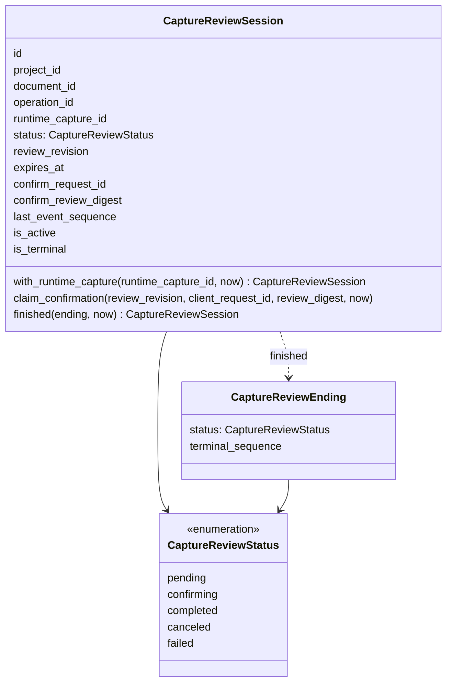
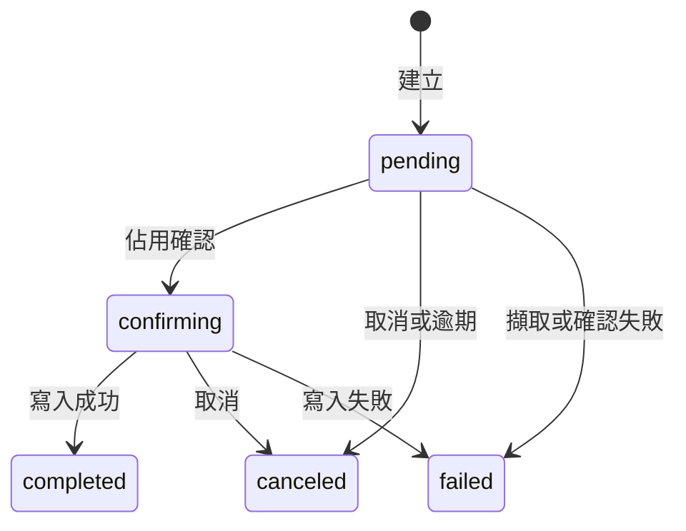
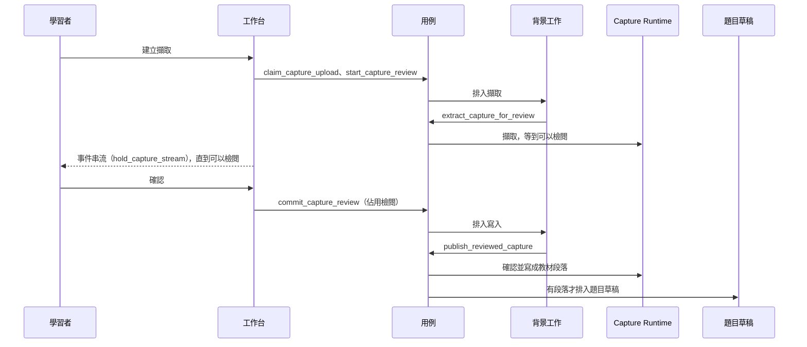

# 擷取整合（Capture Integration）

程式：`apps/cert-prep-backend/src/cert_prep_backend/capture_integration`。

## 負責與不負責

負責：學習者上傳 PDF 或圖片後，請 Capture Runtime 擷取文字、在確認前檢閱、確認後寫成教材段落，並在有段落時排入題目草稿。也負責這個程序裡 runtime 的就緒、來源證明、需求與安裝。

不負責：教材與段落怎麼存（教材來源）、題目草稿怎麼寫（題目編寫）、專案本身（學習專案）、Capture Runtime 的協定與傳輸。SDK 型別留在 infrastructure。不經檢閱的上傳仍在 `routers/documents.py`。

## 用語

| 中文                  | 程式名稱                              | 意思                                               |
| --------------------- | ------------------------------------- | -------------------------------------------------- |
| 擷取檢閱              | `CaptureReviewSession`                | 一次擷取的確認，從擷取到學習者確認為止             |
| 擷取檢閱狀態          | `CaptureReviewStatus`                 | 等待、確認中、完成、取消，或失敗                   |
| 擷取檢閱的結束        | `CaptureReviewEnding`                 | 要求檢閱進入完成、取消或失敗，以及結束時的事件序號 |
| 擷取檢閱無法轉換      | `CaptureReviewTransitionError`        | 檢閱的狀態不允許這次轉換                           |
| 準備好的擷取來源      | `PreparedCaptureSource`               | 準備後的種類、副檔名與頁數                         |
| 擷取檢閱儲存庫        | `CaptureReviewStore`                  | 讀出、建立、觀察序號與結束檢閱                     |
| 擷取用的教材          | `CaptureDocuments`                    | 讀教材、來源檔與段落，並在建立時掛上教材           |
| 擷取用的匯入作業      | `CaptureOperations`                   | 佔用、取消、失敗與讀出匯入作業                     |
| 擷取用的檔案庫        | `CaptureFileStore`                    | 準備、存放與讀取上傳檔                             |
| 擷取檢閱流程          | `CaptureReviewWorkflow`               | 摘要、佔用確認、開始擷取與寫入                     |
| 擷取檢閱維護          | `CaptureReviewMaintenance`            | 取消逾期的檢閱，以及程序起停時收回仍在進行的檢閱   |
| 擷取 runtime          | `CaptureRuntime`                      | 檢閱期間對 runtime 的讀取、結構化、取消與刪除      |
| 擷取背景工作          | `CaptureBackgroundWork`               | 把擷取與寫入排進背景                               |
| 擷取檢閱事件          | `CaptureReviewEvents`                 | 叫醒事件串流：runtime 身份、可檢閱、結束           |
| 擷取事件信號          | `CaptureEventSignal`                  | 一輪等待用的修訂號；不放在事件埠上                 |
| 擷取後的題目草稿      | `CaptureQuestionDrafting`             | 寫入後為教材排入題目草稿                           |
| runtime 設定          | `CaptureRuntimeSetup`                 | 就緒、來源證明、需求與安裝；結果保持不透明         |
| 上傳佔用              | `CaptureUploadClaim`                  | 這次請求有沒有佔到作業 id                          |
| 已排入的確認          | `QueuedCaptureCommit`                 | 確認已完成而重播，或已排進背景寫入                 |
| 已記錄的結構化失敗    | `ReportedStructuringFailure`          | 已記下失敗，或重播一個不再進行的檢閱               |
| 已開始的擷取檢閱      | `StartedCaptureReview`                | 新接受的上傳要投影的檢閱與教材                     |
| 結構化失敗回報        | `StructuringFailureNotice`            | runtime 接受失敗回報後的序號與作業                 |
| runtime 取消結果      | `RuntimeCancellation`                 | runtime 接受取消後的序號與作業                     |
| 看到的擷取            | `ViewedCapture`                       | 要顯示的檢閱、教材，以及要不要改報擷取中           |
| 已存的擷取結果        | `StoredCapture`                       | 已完成檢閱的教材、段落與來源顯示                   |
| runtime 上的擷取結果  | `CaptureResultView`                   | 尚未釋放的 runtime 結果                            |
| 一輪串流等待          | `CaptureStreamHold`                   | 一輪等待的檢閱，以及這輪是否仍在等                 |
| OCR 摘要              | `CaptureOcrSummaryRead`               | 穩定的 OCR 證據，也是這條路由的回應模型            |
| OCR 頁面摘要          | `CaptureOcrPageSummaryRead`           | 一頁的辨識結果                                     |
| OCR 失敗              | `CaptureOcrFailureRead`               | 摘要裡的失敗                                       |
| OCR 來源證明          | `CaptureOcrProvenanceRead`            | 已解析或不可用的來源證明                           |
| 已解析的 OCR 來源證明 | `CaptureOcrResolvedProvenanceRead`    | 來源證明已對上                                     |
| 不可用的 OCR 來源證明 | `CaptureOcrUnavailableProvenanceRead` | 來源證明不可用與原因                               |
| OCR 摘要無法採用      | `OcrSummaryValidationError`           | 摘要與投影對不上                                   |
| 拒絕音訊              | `CaptureAudioRejected`                | 擷取檢閱不接受音訊                                 |
| 擷取已取消            | `CaptureExtractionCanceled`           | 作業已取消，擷取停止                               |
| 擷取需求不可用        | `CaptureRequirementUnavailable`       | 來源依賴還沒就緒                                   |
| 擷取失敗              | `CaptureExtractionFailed`             | 擷取失敗，帶著代碼與結束序號                       |
| runtime 呼叫失敗      | `CaptureRuntimeCallFailed`            | runtime 呼叫失敗，而且不是已經不在                 |
| 擷取檢閱衝突          | `CaptureReviewConflict`               | 這次確認不被接受；router 回答 409                  |
| 擷取修訂無效          | `CaptureReviewInputRejected`          | 修訂對不上原始擷取；router 回答 422                |
| 確認未能排入          | `CaptureCommitNotQueued`              | 確認的背景工作排不進去；router 回答 503            |
| runtime 未確認        | `CaptureGatewayRejection`             | runtime 沒有確認回報、取消或刪除；router 回答 502  |
| OCR 摘要尚未就緒      | `CaptureOcrNotReady`                  | OCR 證據還不穩定；router 回答 409                  |
| 擷取檢閱已關閉        | `CaptureOcrClosed`                    | 檢閱已關閉，不再提供 OCR；router 回答 410          |
| OCR 摘要不可用        | `CaptureOcrUnavailable`               | OCR 證據不能顯示；router 回答 502                  |
| OCR 傳輸失敗          | `CaptureOcrTransport`                 | OCR 讀取連不上 runtime；router 回答 503            |
| OCR 找不到擷取        | `CaptureOcrMissing`                   | 這次 OCR 沒有對應的擷取；router 回答 404           |
| 擷取結果不符契約      | `CaptureResultProtocolError`          | runtime 結果不符 v2 契約；router 回答 502          |
| 擷取結果不可用        | `CaptureResultUnavailable`            | runtime 結果讀不到；router 回答 502                |
| runtime 結果已不在    | `CaptureResultMissing`                | runtime 結果已刪除，改用存檔                       |
| 擷取事件串流中斷      | `CaptureEventStreamFailed`            | 事件串流失敗；尚未送出且為 404 時可以改走宿主結束  |
| 來源紀錄不見          | `CaptureSourceMissing`                | 已完成擷取的教材失去來源紀錄，不以 404 回答        |
| runtime 設定被拒絕    | `CaptureRuntimeSetupRejected`         | 設定呼叫被拒絕；router 用它重組原本的錯誤回應      |

## 聚合與不變條件

- 狀態只有 pending、confirming、completed、canceled、failed。進行中是前兩個。結束是後三個。
- 只有 pending 能記下 runtime 擷取 id，也只有 pending 能佔用確認。
- 確認中若是同一個請求與同一份摘要，回傳原來的檢閱，不再佔用。同一個請求配上不同摘要會被拒絕。呼叫端寫入的 revision 是 1。
- 進行中的檢閱可以結束為完成、取消或失敗。已經結束的檢閱不改狀態；有給更大的事件序號才把序號往前。
- 有給結束序號時必須是正整數。沒給時，進行中的檢閱用目前序號加一。
- 觀察到的事件序號只會變大，用 MAX 比較，而且必須是非負整數，不能是布林。
- 建立後 1800 秒到期。到期時間不會延長。清理時取消仍在進行且已到期的檢閱。
- 一個專案裡，一份教材一個檢閱，一個匯入作業一個檢閱。
- 檢閱修訂要指向存在的片段，文字不能是空白。和 runtime 原文相同的修訂不留下。
- 確認時候選的 SHA-256 要等於教材。寫入時再對一次來源檔的 SHA-256。
- 工作台建立只接受 PDF 與圖片。
- PDF 區塊必須是頁面定位，音訊區塊必須是時間定位。空的投影不寫入。擷取引擎必須是 `windowsml-ocr`，存成 `windowsml_ocr`。
- 檢閱疊加只能改區塊與文件的 targetText。
- 公布 OCR 需要投影、已解析的來源證明，而且頁面證明要一致。

## 用例

| 用例                  | 程式名稱                      | 說明                                              |
| --------------------- | ----------------------------- | ------------------------------------------------- |
| 認領上傳              | `claim_capture_upload`        | 確認專案存在並佔用作業 id；重複的 id 不視為錯誤   |
| 開始擷取檢閱          | `start_capture_review`        | 存檔、建立教材與檢閱，並把擷取排進背景            |
| 放棄上傳              | `abandon_capture_upload`      | 建立失敗時把作業標成失敗；已有檢閱才結束檢閱      |
| 擷取以供檢閱          | `extract_capture_for_review`  | 背景執行擷取；取消、缺需求與失敗各有收尾          |
| 確認擷取檢閱          | `commit_capture_review`       | 比對候選與請求，佔用檢閱，並排入寫入              |
| 寫入已確認的擷取      | `publish_reviewed_capture`    | 背景寫入教材；有段落才排題目草稿                  |
| 回報結構化失敗        | `report_structuring_failure`  | 不再進行中就重播，否則記下失敗                    |
| 取消擷取檢閱          | `cancel_capture_review`       | 取消進行中的檢閱與 runtime 作業                   |
| 丟棄 runtime 擷取     | `discard_capture_runtime`     | 刪除暫存的 runtime 作業；沒有 id 或已刪除則跳過   |
| 逾期擷取檢閱          | `expire_capture_reviews`      | 取消確認期限已過的檢閱                            |
| 收回擷取檢閱          | `recover_capture_reviews`     | 程序起停時取消仍在進行的檢閱                      |
| 查看擷取              | `view_capture`                | 依檢閱與 runtime 狀態決定要顯示哪一份作業         |
| 查看 OCR 摘要         | `view_ocr_summary`            | 在檢閱仍開著時回傳穩定的 OCR 證據                 |
| 查看部分擷取          | `view_partial_capture`        | 檢閱中且已有 runtime id 才回傳部分結果            |
| 查看原始擷取          | `view_raw_capture`            | 檢閱中且已有 runtime id 才回傳原始擷取            |
| 預覽結構化            | `preview_capture_structure`   | 檢查修訂並請 runtime 結構化；不寫入檢閱           |
| 載入已完成的擷取      | `load_completed_capture`      | 完成後讀出教材與段落，供結果投影                  |
| 讀取 runtime 結果     | `read_runtime_result`         | 讀成功才推進序號；runtime 已刪除則改走存檔        |
| 釋放 runtime 結果     | `release_capture_result`      | 結果模型組好之後刪除 runtime 作業，失敗也照樣回傳 |
| 推進擷取事件序號      | `note_capture_event`          | 串流收到一筆事件就記下序號                        |
| 等待擷取串流          | `hold_capture_stream`         | 等 runtime 身份、結束狀態或可檢閱，一次一輪       |
| 查看 runtime 就緒     | `view_runtime_ready`          | 只做 handshake                                    |
| 查看 runtime 來源證明 | `view_runtime_provenance`     | 讀安裝包與一次即時 handshake                      |
| 列出 runtime 需求     | `list_runtime_requirements`   | 列出 runtime 回報的安裝需求                       |
| 開始 runtime 安裝     | `start_runtime_installation`  | 同意與冪等鍵由 router 先檢查，然後開始安裝        |
| 列出 runtime 安裝     | `list_runtime_installations`  | 列出安裝作業                                      |
| 查看 runtime 安裝     | `view_runtime_installation`   | 讀一筆安裝；終態會清掉 discovery 快取             |
| 取消 runtime 安裝     | `cancel_runtime_installation` | 取消一筆安裝                                      |

不經檢閱的上傳仍在 `routers/documents.py`，不是上表的用例。

## 主要流程

`create_app` 把檢閱儲存、流程、維護、runtime、背景工作、事件，以及 `ClientCaptureRuntimeSetup` 放在 `app.state`。router 只依 port 呼叫用例。

## 與其他上下文的關係

- 教材來源：經擷取整合自己的 `CaptureDocuments`、`CaptureOperations`、`CaptureFileStore`。教材來源的 adapter 滿足這些 Protocol，教材來源不 import 擷取整合。`persistence` 與 `review_workflow` 仍直接呼叫教材來源的 infrastructure。
- 題目編寫：寫入後經 `CaptureQuestionDrafting` 排入題目草稿。
- 學習專案：建立擷取時用 `require_project` 確認專案存在。
- Capture Runtime：anticorruption layer（D8）。`application` 不得 import `capture_runtime_client`。SDK 型別留在 infrastructure，以及 router 的回應模型。
- `routers/documents.py`：不經檢閱的上傳仍在那裡（C6）。它呼叫 coordinator 與 `publish_capture_document`，不建立檢閱。

擷取整合不依賴練習與複習、執行環境（import-linter「Capture Integration, Practice and Runtime Provisioning do not depend on each other」）。

## 規則與資料來源

- 資料表：`capture_review_sessions`。migration 25 建立表，26 加上 `confirm_request_id` 與 `confirm_review_digest`，28 加上 `last_event_sequence`。都在 `platform/database.py`。
- HTTP：`/projects/{project_id}/capture-workbench/captures` 與 `/capture-runtime`。事件是工作台下的 `GET /{capture_id}/events`，`text/event-stream`。
- 安裝請求的 `consent: true` 與 UUID `X-Idempotency-Key` 留在 router。安裝進入 `completed`、`failed`、`cancelled` 或 `manual_action_required` 時，client 清掉 discovery 快取。
- `CaptureReviewStatus` 不是 OpenAPI 的列舉，概念集沒有對應項目。
- 已知例外仍在 `apps/cert-prep-backend/pyproject.toml`：工作台 router 對 `api.dependencies`、`routers.documents`、`host_models`、`runtime_policy`；runtime router 對 `host_models`；`persistence` 與 `review_workflow` 對教材來源的 infrastructure。
