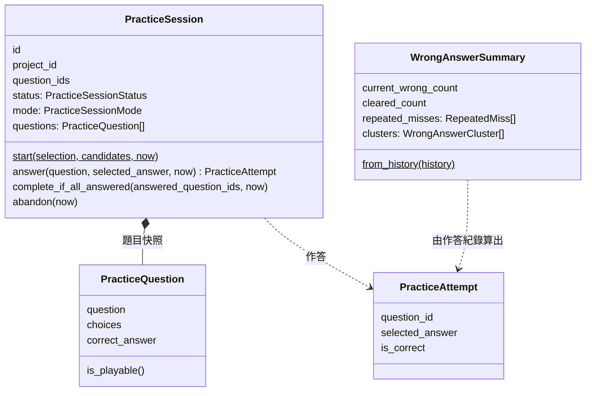
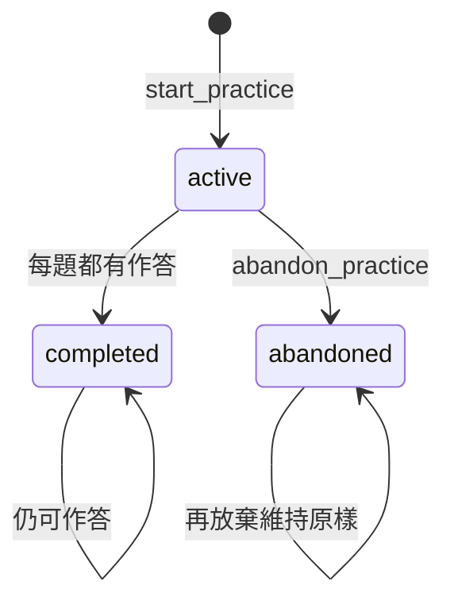
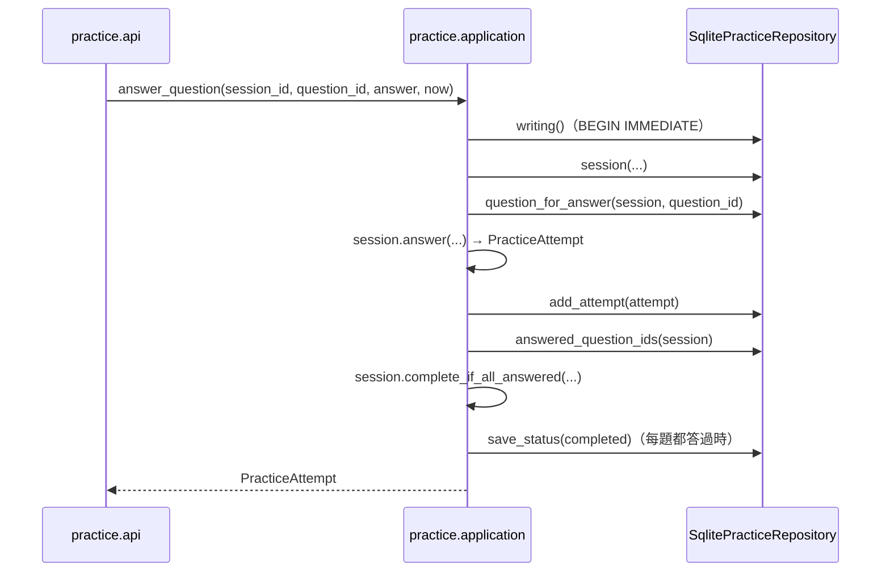

# 練習與複習（Practice and Review）

程式：`apps/cert-prep-backend/src/cert_prep_backend/practice`。

## 負責與不負責

負責：用已核可的題目開始練習（隨機抽題、整份教材、錯題重練），記錄每一次作答與對錯，判斷練習何時完成，整理錯題與錯題總覽，並請 AI 解說錯題。

不負責：題目怎麼產生與核可（題目編寫）、教材與頁碼（教材來源）、用哪個 LLM 解說（AI 供應）。練習只讀它們的結果。

## 用語

| 中文     | 程式名稱             | 意思                                                     |
| -------- | -------------------- | -------------------------------------------------------- |
| 練習     | `PracticeSession`    | 一次作答；模式有整份、隨機抽題、錯題重練                 |
| 練習題目 | `PracticeQuestion`   | 練習問的一題：開始時的快照，之後改草稿不影響已開始的練習 |
| 選題     | `QuestionSelection`  | 新練習問哪些題、題數，以及隨機抽題的種子                 |
| 作答     | `PracticeAttempt`    | 對一題的一次作答與對錯                                   |
| 作答紀錄 | `AnsweredQuestion`   | 一次作答與當時問的題目                                   |
| 錯題     | `WrongAnswer`        | 最近一次作答答錯、待複習的題目                           |
| 錯題總覽 | `WrongAnswerSummary` | 目前錯題、已訂正與重複答錯的題目，依教材頁碼分組         |

完整對照見 [glossary](../../.agents/PLANS/ddd-refactor/glossary.md)；API 的列舉值對應到[概念集](../../packages/cert-prep-contracts/vocabulary/cert-prep-vocabulary-v1.json)。

## 聚合與不變條件

- 只有可練習的題目能進入新練習：已核可、題目與至少兩個選項不是空白、正確答案在選項裡、有解說，並有頁碼或原文摘錄（`PracticeQuestion.is_playable`）。錯題重練直接用錯題本身，不再檢查。
- 開始時決定題目並保存快照（`select_questions`）：隨機抽題預設 10 題，用保存的種子抽；整份教材依教材順序；錯題重練依錯題順序。一個專案同時只能有一個進行中的練習。
- 作答的題目必須屬於這次練習，選的答案必須是題目的選項；已放棄的練習不能再作答，已完成的仍可作答。
- 每一題都有作答後，進行中的練習變成完成；已完成的練習不能放棄，已放棄的再放棄維持原樣。
- 錯題是「最近一次作答答錯」的題目；答錯過、最近一次答對的題目算已訂正。

## 用例

| 用例       | 程式名稱               | 說明                                                         |
| ---------- | ---------------------- | ------------------------------------------------------------ |
| 開始練習   | `start_practice`       | 依模式選題、保存題目快照；已有進行中的練習時衝突             |
| 列出進行中 | `list_active_practice` | 專案進行中的練習（最多一個）                                 |
| 查看練習   | `view_practice`        | 練習、題目快照與作答                                         |
| 放棄練習   | `abandon_practice`     | 進行中的練習改為放棄；已完成的不能放棄                       |
| 作答       | `answer_question`      | 評分並記錄作答，每題都答過時完成練習                         |
| 列出錯題   | `list_wrong_answers`   | 目前的錯題，由新到舊                                         |
| 錯題總覽   | `review_wrong_answers` | 目前錯題、已訂正、重複答錯與依頁分組                         |
| 請求解說   | `request_explanation`  | 用 LLM 解說一題目前的錯題；沒有可用的 LLM 時給出固定格式說明 |

## 主要流程

`create_app` 建立 `SqlitePracticeStore` 放在 `app.state.practice_store`；router 只依 `PracticeStore` 這個 port 呼叫用例。寫入的用例在同一個 `BEGIN IMMEDIATE` 交易裡讀、判斷、寫，兩個請求同時開始練習時只有一個成功。

## 與其他上下文的關係

- 學習專案：練習屬於一個專案；專案不存在時是 404。
- 題目編寫：練習讀 `question_drafts` 裡已核可的題目（資料表歸屬在 C5 定案）。
- 教材來源：整份教材模式先確認教材屬於這個專案。
- AI 供應：解說錯題用 LLM provider；它現在由 `api.dependencies` 提供，AI 供應拆出後改由它提供（已知例外）。

其他上下文只能經 `practice.application` 與 `practice.domain` 使用練習（import-linter「Other contexts reach Practice and Review only through its application and domain」）。

## 規則與資料來源

- 資料表：`practice_sessions`、`practice_session_questions`（題目快照）、`practice_attempts`；migration 在 `platform/database.py`。
- HTTP：`/projects/{project_id}/practice-sessions`、`/projects/{project_id}/wrong-answers`（DTO 在 `practice/api/schemas.py`）。
- API 的 `PracticeSessionStatus`、`PracticeSessionMode` 列舉值對應到概念集的 `practice.session-status.*`、`practice.session-mode.*`。
