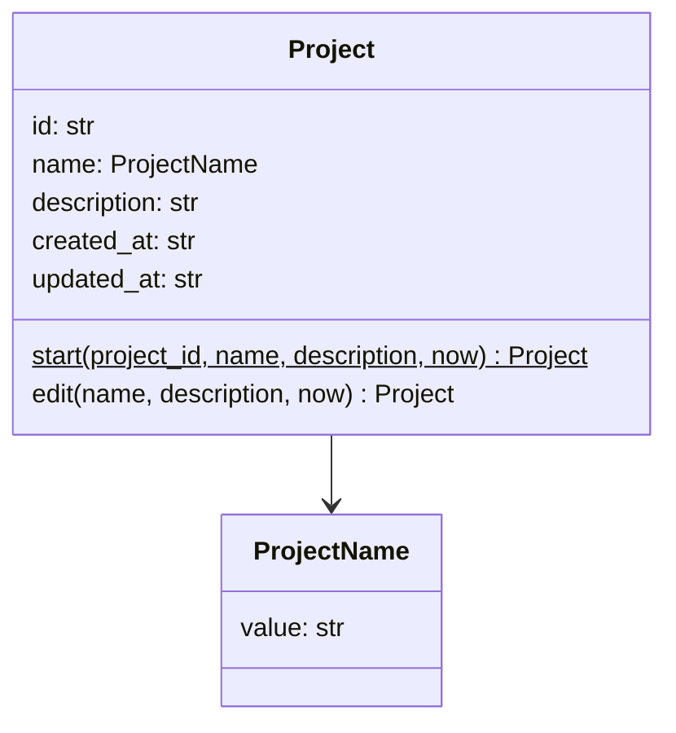
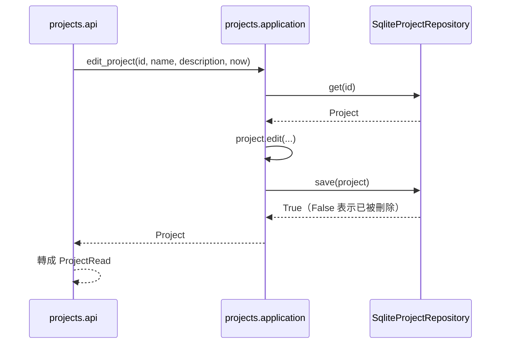

# 學習專案（Study Projects）

程式：`apps/cert-prep-backend/src/cert_prep_backend/projects`。

## 負責與不負責

負責：一個學習專案的身分（id）、名稱與說明，以及建立、修改、刪除與列出專案。其他上下文的工作都屬於某個專案，開始前先確認專案存在。

不負責：專案裡的教材、題目、練習與複習。它們屬於各自的上下文，只記錄自己屬於哪個專案。

## 用語

| 中文     | 程式名稱      | 意思                                     |
| -------- | ------------- | ---------------------------------------- |
| 學習專案 | `Project`     | 一組教材、題目與練習的範圍，例如一次檢定 |
| 專案名稱 | `ProjectName` | 專案的名稱，不能是空字串                 |

完整對照見 [glossary](../../.agents/PLANS/ddd-refactor/glossary.md)。

## 聚合與不變條件

- 專案名稱不能是空字串（`ProjectName`）。API 也以 `min_length=1` 先擋下；名稱照使用者輸入保存，不去掉空白。
- 專案的 `id` 與 `created_at` 建立後不再改變；修改只改給定的名稱或說明，並更新 `updated_at`。
- `Project` 不可變，修改得到新的物件，由 repository 存回。

## 用例

| 用例           | 程式名稱          | 說明                                               |
| -------------- | ----------------- | -------------------------------------------------- |
| 建立專案       | `create_project`  | 以名稱與說明建立專案，產生新的 id                  |
| 列出專案       | `list_projects`   | 由新到舊列出所有專案                               |
| 查看專案       | `get_project`     | 取得一個專案；不存在時是 `NotFoundError`           |
| 修改專案       | `edit_project`    | 改名稱或說明，沒給的保持原值                       |
| 刪除專案       | `delete_project`  | 刪除專案；不存在時是 `NotFoundError`               |
| 確認專案存在   | `require_project` | 給其他上下文：開始屬於某個專案的工作前，確認它存在 |
| 確認專案在不在 | `project_exists`  | 專案是否還在；練習與教材來源經自己的 port 讀它     |

## 主要流程

`create_app` 建立 `SqliteProjectRepository` 放在 `app.state.project_repository`；router 只依 `ProjectRepository` 這個 port 呼叫用例，不直接碰 SQLite。

## 與其他上下文的關係

學習專案是最上游的上下文，不依賴任何其他上下文（import-linter「Study Projects does not depend on other contexts」）。

練習在自己的 `BEGIN IMMEDIATE` 交易裡經 port 呼叫 `project_exists`（`bootstrap/study_projects.py` 的 `ProjectExistence`；`bootstrap/practice_reads.py` 把練習的連線交給 `SqliteProjectRepository`）。教材來源的 repository 經它的 port `StudyProjects` 呼叫 `project_exists`（`bootstrap/source_library_links.py`），用自己的連線。

教材來源與擷取整合經 port `ProjectRepository` 與 `require_project` 確認專案存在；題目編寫經 port `StudyProjects` 與 `project_exists` 確認專案存在，由 `bootstrap/study_projects.py` 接線。該契約的所有已知例外已在 C5 第三部分完全消除。

## 規則與資料來源

- 資料表 `projects`（`id`、`name`、`description`、`created_at`、`updated_at`）屬學習專案，migration 在 `platform/database.py`。
- HTTP：`/projects`（`ProjectCreate`、`ProjectUpdate`、`ProjectRead`、`ProjectList`，在 `projects/api/schemas.py`）。
- 錯誤訊息「Project not found.」由 router 轉成 404 的 `not_found` 錯誤。

## 前端

程式：`apps/cert-prep/src/app/projects`（C7 第一部分）。規則在 `sheriff.config.ts`：每一層是一個 Sheriff 模組，標上 `context:projects` 與 `type:<層>`，別的模組只能經它的 `index.ts` 引用。

| 層        | 公開（`index.ts`）     | 內容                                                                                                                                    |
| --------- | ---------------------- | --------------------------------------------------------------------------------------------------------------------------------------- |
| `data`    | `ProjectStore`         | 專案清單（`/projects` 的 HTTP resource）、目前選的專案、建立專案表單的狀態與 `createFromForm`；`providedIn: 'root'`                     |
| `feature` | `ProjectRailComponent` | 側欄的專案清單與建立專案表單（`app-project-rail`）；使用者點選或建立專案時送出 `projectSelected`（專案 id），建立時先送出事件再關閉表單 |

沒有 `ui` 與 `domain`：專案的型別（`ProjectRead`）是產生的 API 型別，放在 `core/domain`。

學習專案是最上游的上下文：`projects` 只引用自己與 `core`（`core/data` 的 `CERT_PREP_API`、`CertPrepHttpResourceClient`、`OperationStore`，`core/domain` 的型別，`core/ui` 的圖示）。它不知道下游：殼層（`core/shell` 的 `App`）接住 `projectSelected`，交給 `WorkspaceFacade.selectProject`，由它重設並載入教材來源、題目編寫與練習的資料。其他上下文經 `projects/data` 讀 `ProjectStore.selectedProjectId` 等狀態。
