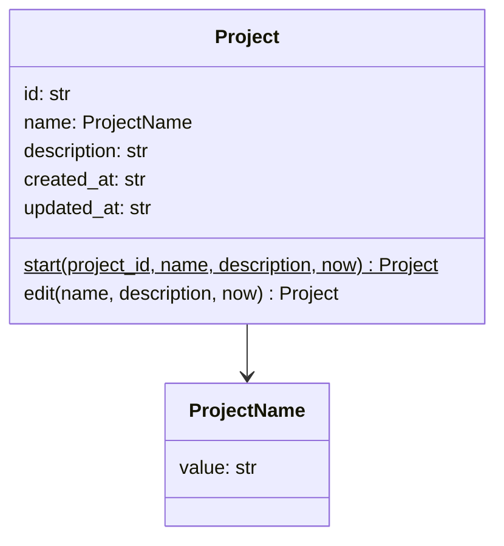
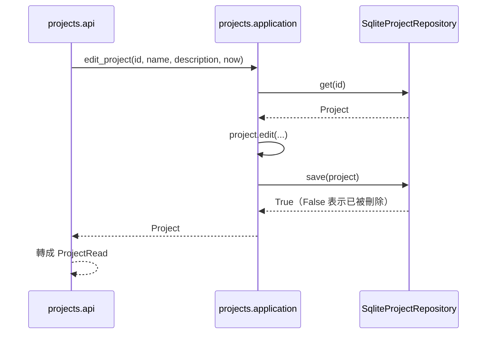

# 學習專案（Study Projects）

程式：`apps/cert-prep-backend/src/cert_prep_backend/projects`。

## 負責與不負責

負責：一個學習專案的身分（id）、名稱與說明，以及建立、修改、刪除與列出專案。其他上下文的工作都屬於某個專案，開始前先確認專案存在。

不負責：專案裡的教材、題目、練習與複習。它們屬於各自的上下文，只記錄自己屬於哪個專案。

## 用語

| 中文     | 程式名稱      | 意思                                     |
| -------- | ------------- | ---------------------------------------- |
| 學習專案 | `Project`     | 一組教材、題目與練習的範圍，例如一次檢定 |
| 專案名稱 | `ProjectName` | 專案的名稱，不能是空字串                 |

完整對照見 [glossary](../../.agents/PLANS/ddd-refactor/glossary.md)。

## 聚合與不變條件

- 專案名稱不能是空字串（`ProjectName`）。API 也以 `min_length=1` 先擋下；名稱照使用者輸入保存，不去掉空白。
- 專案的 `id` 與 `created_at` 建立後不再改變；修改只改給定的名稱或說明，並更新 `updated_at`。
- `Project` 不可變，修改得到新的物件，由 repository 存回。

## 用例

| 用例         | 程式名稱          | 說明                                               |
| ------------ | ----------------- | -------------------------------------------------- |
| 建立專案     | `create_project`  | 以名稱與說明建立專案，產生新的 id                  |
| 列出專案     | `list_projects`   | 由新到舊列出所有專案                               |
| 查看專案     | `get_project`     | 取得一個專案；不存在時是 `NotFoundError`           |
| 修改專案     | `edit_project`    | 改名稱或說明，沒給的保持原值                       |
| 刪除專案     | `delete_project`  | 刪除專案；不存在時是 `NotFoundError`               |
| 確認專案存在 | `require_project` | 給其他上下文：開始屬於某個專案的工作前，確認它存在 |

## 主要流程

`create_app` 建立 `SqliteProjectRepository` 放在 `app.state.project_repository`；router 只依 `ProjectRepository` 這個 port 呼叫用例，不直接碰 SQLite。

## 與其他上下文的關係

學習專案是最上游的上下文，不依賴任何其他上下文（import-linter「Study Projects does not depend on other contexts」）。

教材來源、題目編寫與擷取整合在開始工作前呼叫 `ensure_project_exists(db, project_id)`，它用 `require_project` 確認專案存在。這些呼叫現在還直接 import `projects.infrastructure`，列為已知例外（「Other contexts reach Study Projects only through its application and domain」）；各上下文做 C4 時改成注入專案查詢，例外隨之移除。

## 規則與資料來源

- 資料表 `projects`（`id`、`name`、`description`、`created_at`、`updated_at`），migration 在 `platform/database.py`；資料表歸屬在 C5 定案。
- HTTP：`/projects`（`ProjectCreate`、`ProjectUpdate`、`ProjectRead`、`ProjectList`，在 `projects/api/schemas.py`）。
- 錯誤訊息「Project not found.」由 router 轉成 404 的 `not_found` 錯誤。
