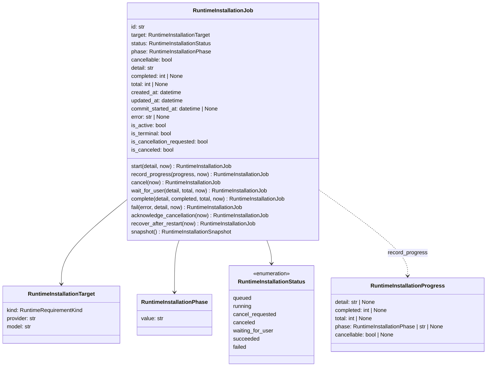
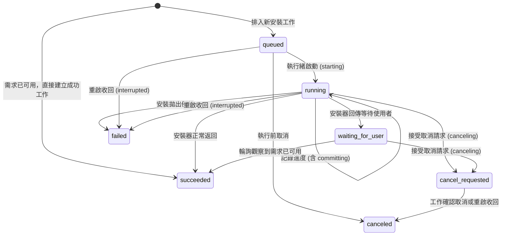
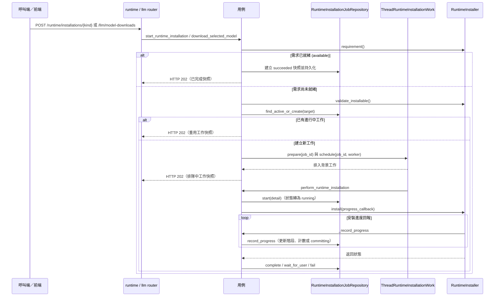

# 執行環境（Runtime Provisioning）

程式：`apps/cert-prep-backend/src/cert_prep_backend/runtime_provisioning`。

## 負責與不負責

負責：
- 檢查與安裝本機端必要的執行環境元件（例如 Ollama 執行環境、Ollama 語言模型）。
- 維護執行環境安裝與模型下載工作（`RuntimeInstallationJob`）的完整生命週期（排隊、啟動、進度更新、取消、等待使用者、重啟收回）。
- 管理安裝工作聚合的記憶體快取與 SQLite 持久化儲存。
- 提供安裝需求與工作狀態的查詢、取消與 SSE（Server-Sent Events）事件串流。

不負責：
- Capture SDK 的設定、來源證明與安裝（屬於擷取整合 Capture Integration）。
- 打包好的 Python 與 Capture Runtime 本機安裝（屬於桌面端 Tauri 宿主，在 Rust 中使用不同的 DTO 與種類處理）。
- 語言模型的推論、選擇、設定檔與執行模式（屬於 AI 供應 AI Providers）。
- 機器硬體盤點（`/runtime/machine-inventory` 委派給 AI 供應的 `inspect_machine`，保留在 runtime router 僅為維持 OpenAPI 路徑相容，屬 D15 例外）。

## 用語

| 中文 | 程式名稱 | 意思 |
| --- | --- | --- |
| 執行環境安裝 | `RuntimeInstallationJob` | 安裝或檢查 Ollama 執行環境與語言模型等本機元件的背景工作 |
| 執行環境安裝目標 | `RuntimeInstallationTarget` | 安裝工作的需求種類、供應者名稱與模型 |
| 執行環境安裝階段 | `RuntimeInstallationPhase` | 安裝工作的技術階段，例如排隊、執行中、提交中等 |
| 執行環境安裝進度 | `RuntimeInstallationProgress` | 安裝工作的進度更新：說明、完成度、總量、階段與是否可取消 |
| 執行環境安裝快照 | `RuntimeInstallationSnapshot` | 執行環境安裝工作對外的序列化檢視 |
| 執行環境安裝已取消 | `RuntimeInstallationCanceledError` | 安裝工作已取消而拒絕狀態轉換的錯誤 |
| 執行環境需求種類 | `RuntimeRequirementKind` | 可安裝的本機相依類別，例如 Ollama 執行環境或模型 |
| 執行環境安裝狀態 | `RuntimeInstallationStatus` | 執行環境安裝工作的生命週期狀態 |
| 執行環境需求快照 | `RuntimeRequirementSnapshot` | 本機執行環境需求可用性快照 |
| 執行環境安裝進度訊息 | `RuntimeInstallProgress` | 具體安裝器回報的進度訊息 |
| 執行環境裝配 | `RuntimeInstallation` | 聚合儲存庫、安裝器目錄與背景工作的裝配容器 |
| 安裝工作儲存庫埠 | `RuntimeInstallationJobs` | 管理安裝工作聚合的記憶體快取與 SQLite 持久化介面 |
| 安裝器目錄埠 | `RuntimeInstallers` | 設定的安裝通道目錄介面，依需求種類排序與選定模型 |
| 背景工作埠 | `RuntimeInstallationWork` | 工作執行緒持有、排程與取消信號介面 |
| 工作執行緒埠 | `RuntimeInstallationWorker` | 背景工作執行緒的等待介面 |
| 安裝器介面 | `RuntimeInstaller` | 單一通道的可用性需求與安裝執行規格 |
| 設定的安裝器目錄 | `ConfiguredRuntimeInstallers` | 滿足 `RuntimeInstallers` 的具體轉接器 |
| 語言模型安裝器 | `LLMModelInstaller` | 銜接 AI 供應的語言模型下載與驗證轉接器 |
| 執行緒背景工作轉接器 | `ThreadRuntimeInstallationWork` | 滿足 `RuntimeInstallationWork` 的具體執行緒與 Event 轉接器 |
| 安裝工作儲存庫 | `RuntimeInstallationJobRepository` | 滿足 `RuntimeInstallationJobs` 的儲存庫轉接器 |

## 聚合與不變條件

| 起始狀態 (From) | 目標狀態 (To) | 觸發動作／條件 (Trigger) |
| --- | --- | --- |
| 無（新工作） | `queued` | 需求尚未就緒、可安裝，且無進行中的工作 |
| 無（新工作） | `succeeded` | 需求已就緒；直接建立持久化的成功工作 |
| `queued` | `running` | 背景工作執行緒啟動；階段設為 `starting` |
| `queued` | `canceled` | 工作執行前被取消 |
| `running` | `running` | 接收到進度更新；包含進入提交邊界（階段設為 `committing` 且不可取消） |
| `running` | `waiting_for_user` | 安裝器返回等待使用者狀態（例如需手動啟動服務或確認） |
| `running` | `succeeded` | 安裝器正常返回非 waiting 狀態 |
| `running` | `failed` | 安裝過程中捕捉到未預期的例外 |
| `running` | `cancel_requested` | 接受取消請求；階段設為 `canceling` |
| `waiting_for_user` | `cancel_requested` | 接受取消請求；階段設為 `canceling` |
| `cancel_requested` | `canceled` | 工作執行緒收尾確認取消，或應用程式重啟時收回 |
| `waiting_for_user` | `succeeded` | 檢視／輪詢工作狀態時，探測發現需求已可用 |
| `queued` | `failed` | 應用程式重啟收回中斷工作；階段設為 `interrupted` |
| `running` | `failed` | 應用程式重啟收回中斷工作；階段設為 `interrupted` |
| `waiting_for_user` | `waiting_for_user` | 應用程式重啟，但重新探測後需求仍未就緒（狀態保持不變） |

### 故意保留的特殊路徑與相容行為

- **終態後的延遲進度更新（Late progress after a terminal state returns to running）**：目前進度處理邏輯在工作已進入終態（`succeeded` 或 `failed`）後若仍收到進度回報，不會拋出錯誤，而是會將狀態更新回 `running`（這是既有管理器的相容行為，刻意保留）。
- **等待中工作的取消保留在要求取消（Cancelling a waiting job stays `cancel_requested` until restart）**：取消處於 `waiting_for_user` 狀態的工作時，由於沒有活躍的工作執行緒來收尾確認，工作狀態會停留在 `cancel_requested`，直到應用程式重新啟動執行 `recover_runtime_installations` 時才會轉為 `canceled`。
- **安裝後探測錯誤發生在處理常式外（Post-install probe errors）**：安裝器正常執行返回後呼叫 `requirement()` 若發生例外，會在工作執行緒的例外捕捉區塊外拋出。
- **正常返回即視為成功（A normal return becomes success even if still unavailable）**：只要安裝器正常執行完畢（且非回傳 `waiting_for_user`），用例即將工作終態標為 `succeeded`，不會強制要求後續探測的 `requirement().available` 必須為 `True`。

### 不變條件與規則

- `committing` 是一個技術階段（`RuntimeInstallationPhase.COMMITTING`），而非狀態列舉。進入提交階段後，工作變為不可取消（`cancellable = False`），並記錄 `commit_started_at`；後續進度更新維持提交中且不可取消。
- 已提交成功的安裝工作不允許被取消；若對已提交且成功的工作呼叫取消，會引發 `OperationNotCancellableError`。
- 跨工作唯一性：同一個需求種類（`RuntimeRequirementKind`）同時只能存在一個進行中（active: `queued`, `running`, `cancel_requested`, `waiting_for_user`）的工作。此規則由 `RuntimeInstallationJobRepository` 的鎖與 SQLite 資料庫的局部唯一索引共同維護，而非由單一聚合自己維護。
- 重試政策：終態後重試會建立一筆新的安裝工作，管理器層級不維護自動重試或退避迴圈。
- 聚合不直接依賴 `Event`、`Lock`、`Thread`、`sqlite3`、UUID 產生或系統時鐘，所有時間與 ID 皆由外部注入。

## 用例

| 用例 | 程式名稱 | 說明 |
| --- | --- | --- |
| 列出執行環境需求 | `list_runtime_requirements` | 依序評估所有已設定的安裝需求 |
| 開始執行環境安裝 | `start_runtime_installation` | 檢查需求、驗證可安裝性、重用進行中工作或排入新工作 |
| 下載選定的模型 | `download_selected_model` | 依選定的模型種類進入安裝流程 |
| 查看執行環境安裝 | `view_runtime_installation` | 讀取工作狀態，若為等待使用者狀態則嘗試重新探測需求 |
| 取消執行環境安裝 | `cancel_runtime_installation` | 要求取消進行中的工作，並呼叫安裝器的取消回呼 |
| 執行執行環境安裝 | `perform_runtime_installation` | 背景工作執行安裝、記錄進度並以聚合更新終態 |
| 收回執行環境安裝 | `recover_runtime_installations` | 應用程式啟動時原子收回資料庫中的中斷工作 |
| 停止執行環境安裝 | `stop_runtime_installations` | 應用程式關閉時請求取消所有進行中工作並等候工作執行緒結束 |

## 主要流程

`create_app` 把 `RuntimeInstallationJobRepository`、`ConfiguredRuntimeInstallers` 與 `ThreadRuntimeInstallationWork` 組合封裝為 `RuntimeInstallation` 放在 `app.state.runtime_installation_manager`。router 只依 port 呼叫用例。

## 埠與轉接器（Ports and Adapters）

### 埠（Ports）
- `RuntimeInstallationJobs`：安裝工作聚合儲存庫介面，提供工作的查詢、建立、更新、列表與重啟收回。
- `RuntimeInstallers`：設定的安裝通道目錄介面，提供按種類順序排列的安裝器清單、指定種類查詢與選定模型種類。
- `RuntimeInstaller`：單一安裝通道介面，提供可用性需求探測（`requirement()`）與安裝執行（`install()`）；可選支援 `validate_installable()` 與 `cancel()`。
- `RuntimeInstallationWork`：背景工作技術排程介面，管理執行緒排程、取消信號與工作執行緒 join。
- `RuntimeInstallationWorker`：工作執行緒介面，提供帶超時的 `join()`。
- 時鐘與 ID 產生：`clock` (`Callable[[], datetime]`) 與 `new_id` (`Callable[[], str]`)。

### 轉接器（Adapters）
- `RuntimeInstallationJobRepository`：位於 `infrastructure/repository.py`，滿足 `RuntimeInstallationJobs`，擁有 reentrant lock、記憶體字典快取與可選的 SQLite 持久化。
- `ConfiguredRuntimeInstallers`：位於 `infrastructure/installers.py`，滿足 `RuntimeInstallers`，支援預設安裝器、選定模型種類與覆寫。
- `LLMModelInstaller`：位於 `infrastructure/installers.py`，滿足 `RuntimeInstaller`，銜接 AI 供應的 `ModelDownloadProvider` 與 `ModelOnboardingProvider`，提供模型準備、下載拉取與驗證承諾。
- `ThreadRuntimeInstallationWork`：位於 `infrastructure/manager.py`，滿足 `RuntimeInstallationWork`，技術持有 `threading.Thread` 與 `threading.Event` 取消信號。

## 與其他上下文的關係

- **AI 供應（AI Providers）**：透過 `LLMModelInstaller` 銜接 `ModelDownloadProvider` 與 `ModelOnboardingProvider`；`/runtime/machine-inventory` 委派給 AI 供應的 `inspect_machine`。AI 供應不依賴執行環境。
- **擷取整合（Capture Integration）**：Capture SDK 的安裝與設定屬於擷取整合（`capture-runtime` 路由），執行環境不處理 Capture SDK 的安裝。
- **桌面端（Tauri）**：打包好的 Python 與 Capture Runtime 本機安裝屬於 Tauri 桌面端，在 Rust 中使用不同的 DTO 與種類處理，不與後端的執行環境安裝混淆。
- **教材來源、題目編寫、練習與複習**：執行環境不直接依賴這些上下文。

## 規則與資料來源

- **資料表**：`runtime_installation_jobs`（SQLite 表，定義在 `platform/database.py`，具有部分唯一索引限制同一需求種類只能有一個進行中的工作）。
- **HTTP 路由與對應用例**：
  - `GET /runtime/requirements` -> `list_runtime_requirements`
  - `GET /runtime/machine-inventory` -> 委派給 AI 供應的 `inspect_machine`（D15 例外）
  - `POST /runtime/installations/{kind}` -> `start_runtime_installation`
  - `GET /runtime/installations/{job_id}` -> `view_runtime_installation`
  - `DELETE /runtime/installations/{job_id}` -> `cancel_runtime_installation`
  - `POST /llm/model-downloads` -> `download_selected_model`
  - `GET /llm/model-downloads/{job_id}` -> `view_runtime_installation`
  - `DELETE /llm/model-downloads/{job_id}` -> `cancel_runtime_installation`
- **SSE 串流路由（定義在 `routers/operation_events.py`）**：
  - `GET /runtime/installations/{job_id}/events` -> 呼叫 `view_runtime_installation`，事件名稱為 `runtime-installation`
  - `GET /llm/model-downloads/{job_id}/events` -> 呼叫 `view_runtime_installation`（排除 `kind`），事件名稱為 `model-download`
- **列舉與概念集對應**：
  - `RuntimeRequirementKind` 對應到 `runtime-provisioning.requirement-kind.*`
  - `RuntimeInstallationStatus`（OpenAPI 元件名稱 `cert_prep_contracts__runtime__RuntimeInstallationStatus`）對應到 `runtime-provisioning.installation-status.*`
