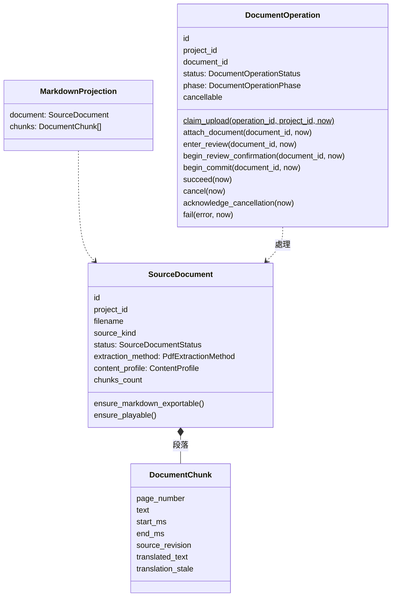
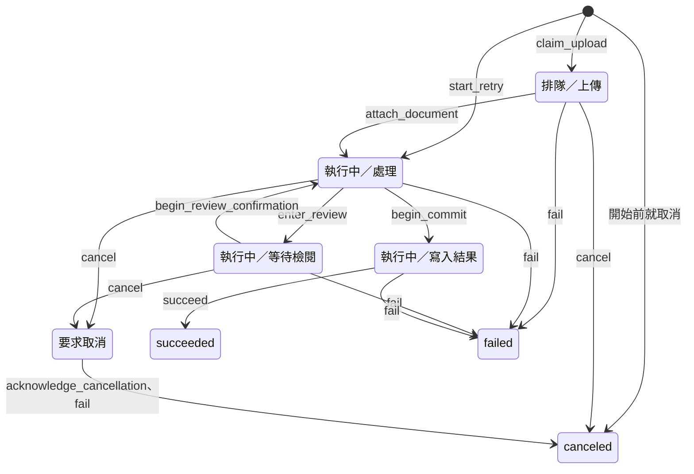
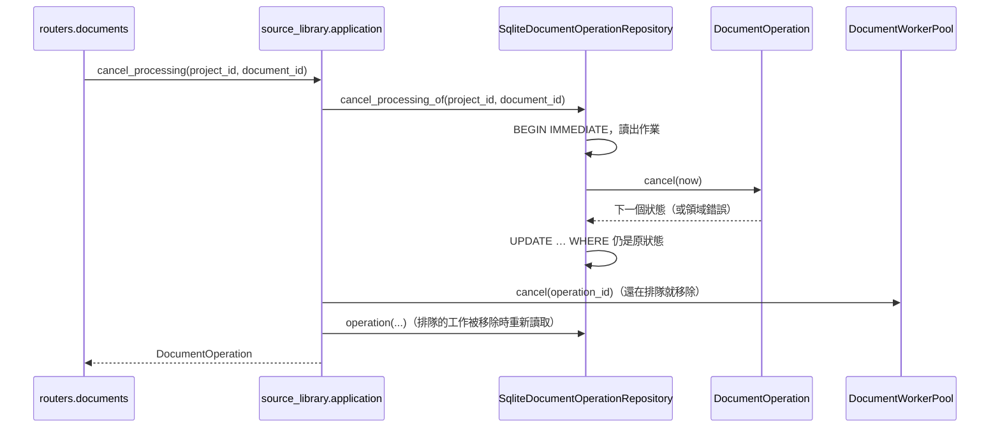

# 教材來源（Source Library）

程式：`apps/cert-prep-backend/src/cert_prep_backend/source_library`。

## 負責與不負責

負責：匯入 PDF、圖片與錄音並保存原始檔；把擷取出的文字切成段落、判斷內容類型；匯入與處理的背景作業（取消、重試、重新開機後復原）；匯出 PDF 的 Markdown、播放錄音；修正錄音的轉錄段落並翻譯成繁體中文。

不負責：OCR 與語音轉文字本身（由擷取整合交給 Capture Runtime）、使用者檢查擷取結果（擷取整合）、由段落產生題目（題目編寫）、用哪個模型翻譯（AI 供應）。

## 用語

| 中文             | 程式名稱                    | 意思                                                   |
| ---------------- | --------------------------- | ------------------------------------------------------ |
| 教材             | `SourceDocument`            | 匯入的一份 PDF、圖片或錄音                             |
| 原始檔           | `SourceFile`                | 匯入的檔案、它的 SHA-256 與存放位置                    |
| 段落             | `DocumentChunk`             | 教材切成的一段文字；錄音的段落有時間區間與翻譯         |
| 教材狀態         | `SourceDocumentStatus`      | 處理中、取消中、已取消、可用，或處理失敗的原因         |
| 擷取結果         | `PdfExtraction`             | 一次擷取得到的頁面、狀態與各階段耗時                   |
| 擷取頁面         | `ExtractedPage`             | 擷取出的一頁文字與擷取方式                             |
| 擷取方式         | `PdfExtractionMethod`       | 內嵌文字、OCR、兩者混合，或沒有文字                    |
| 內容類型         | `ContentProfile`            | 教材的題型慣例，例如 `jlpt_vocabulary`、`jlpt_grouped` |
| 題目形式         | `QuestionItemKind`          | 一題是單獨的字彙題，還是題組裡的一題                   |
| Markdown 匯出    | `MarkdownProjection`        | 可匯出的 PDF 與用來產生 Markdown 的段落                |
| 教材無法提供     | `SourceDocumentUnavailable` | 教材不能以要求的形式提供，例如圖片沒有 Markdown        |
| 匯入作業         | `DocumentOperation`         | 一次匯入、擷取、檢閱或重試，以及它還能不能取消         |
| 作業狀態         | `DocumentOperationStatus`   | 排隊、執行中、要求取消、已取消、成功、失敗             |
| 作業階段         | `DocumentOperationPhase`    | 上傳、處理、等待檢閱、轉錄、翻譯、取消中、寫入結果等   |
| 失敗後的教材狀態 | `DocumentFailureState`      | 作業失敗或取消後，頁面教材留下的狀態，之後可以重試     |

完整對照見 [glossary](../../.agents/PLANS/ddd-refactor/glossary.md)；API 的列舉值對應到[概念集](../../packages/cert-prep-contracts/vocabulary/cert-prep-vocabulary-v1.json)。

## 聚合與不變條件

教材（`SourceDocument`）：

- 只有處理完成的 PDF 能匯出 Markdown，而且至少要有一個段落（`ensure_markdown_exportable`、`MarkdownProjection`）。
- 只有錄音能播放；播放前確認原始檔仍在專案的上傳資料夾、大小在上限內、SHA-256 與匯入時相同（`ensure_playable`、`open_audio_source`）。
- 修正轉錄段落時去掉前後空白，不能是空字串；修正後段落的版本加一，它的翻譯變成過期（`edited_transcript_text`、`DocumentChunk.translation_stale`）。
- 狀態是可用、有文字、已處理的頁數大於 0 的教材才能產生題目（`SourceDocumentLifecyclePolicy`）。

匯入作業（`DocumentOperation`）：

- 一個作業 id 只屬於一個專案；別的專案用同一個 id 是衝突。
- 新上傳的作業排隊等待上傳；附上教材後開始處理。只有剛認領、還沒有教材的作業能附上教材。
- 排隊中的作業取消時直接變成已取消。在可以取消的階段（處理、等待檢閱、轉錄、翻譯）取消時，先記為要求取消，工作停下後再確認為已取消。
- 開始寫入結果之後不能取消；取消與寫入同時發生時只有一個成功。
- 等待使用者檢閱時仍可取消；確認後回到處理，同一次檢閱只能確認一次。
- 已要求取消的作業失敗時記為已取消，不記錯誤。失敗或取消的頁面教材回到可以重試的狀態（`failure_state`）；錄音保留已經轉錄的段落。
- 重試要用新的作業 id；教材必須是可重試的結果（已取消、OCR 失敗、沒有文字、轉錄失敗），而且沒有進行中的作業（`ensure_retry_allowed`）。
- 每一次轉換由 `DocumentOperation` 決定；存回時以「仍是決定時的狀態」為條件，狀態已被別的請求改變就失敗，不會覆蓋。

## 用例

| 用例          | 程式名稱                   | 說明                                                                       |
| ------------- | -------------------------- | -------------------------------------------------------------------------- |
| 列出教材      | `list_documents`           | 專案的所有教材                                                             |
| 查看教材      | `view_document`            | 一份教材與它的處理結果                                                     |
| 匯出 Markdown | `export_markdown`          | 處理完成的 PDF 依段落產生 Markdown；其他教材是 `SourceDocumentUnavailable` |
| 播放錄音      | `open_audio_source`        | 驗證過完整性的錄音原始檔                                                   |
| 查看作業      | `view_operation`           | 一個匯入作業的狀態與階段                                                   |
| 取消作業      | `cancel_operation`         | 取消一個作業；還沒開始的作業 id 先記為已取消，之後不能再用                 |
| 取消處理      | `cancel_processing`        | 取消正在處理一份教材的作業                                                 |
| 列出段落      | `list_chunks`              | 教材的段落，依頁碼或時間排列                                               |
| 修正段落      | `edit_chunk`               | 修正一段轉錄文字；它的翻譯變成過期                                         |
| 翻譯段落      | `translate_chunk`          | 把一段轉錄翻譯成繁體中文                                                   |
| 翻譯過期段落  | `translate_stale_chunks`   | 翻譯所有修正後還沒重新翻譯的段落                                           |
| 重新開機復原  | `recover_interrupted_work` | 確認已要求的取消、讓中斷的作業失敗、整理仍標成處理中的教材                 |

匯入與重試教材的流程現在仍在 `routers/documents.py`：它同時驅動擷取檢閱與題目草稿，C6 把擷取規則移出 router 時才移入這裡的用例。

## 主要流程

`create_app` 建立 `SqliteDocumentRepository`、`SqliteDocumentOperationRepository`、`LocalSourceFileStore`、`OllamaChunkTranslator`，放在 `app.state.document_repository`、`document_operation_repository`、`source_file_store`、`chunk_translator`；router 只依 `application/ports.py` 的 port 呼叫用例。作業的每一次轉換是一個交易，在 repository 裡讀出作業、交給 `DocumentOperation` 決定、以原狀態為條件寫回。

## 與其他上下文的關係

- 學習專案：教材與作業屬於一個專案；專案不存在時是 404。教材來源只需要專案 id，所以直接讀 `projects` 資料表確認專案存在（資料表歸屬在 C5 定案）。
- 擷取整合：上傳的擷取在使用者確認後寫成教材段落；現在直接呼叫 `source_library.infrastructure` 的作業與段落函式（已知例外，擷取整合的 C4 與 C6 改經 `source_library.application`）。
- 題目編寫：讀段落與內容類型產生題目，並更新教材的題目數；現在也直接呼叫 infrastructure（已知例外，題目編寫的 C4 改經 application）。
- 練習與複習：整份教材模式先確認教材屬於這個專案（讀 `documents` 資料表）。
- AI 供應：翻譯用 Ollama 模型（`OllamaTraditionalChineseTranslator` 暫在 `infrastructure/audio.py`，AI 供應拆出後改由它提供）。

其他上下文只能經 `source_library.application` 與 `source_library.domain` 使用教材來源（import-linter「Other contexts reach Source Library only through its application and domain」）；現有的直接引用列為已知例外，之後的 PR 只能減少。

## 規則與資料來源

- 資料表：`documents`、`document_chunks`、`document_operations`；migration 在 `platform/database.py`。
- 原始檔：`<data_dir>/uploads/<project_id>/<sha256><副檔名>`（`infrastructure/storage.py`）。
- HTTP：`/projects/{project_id}/documents`、`/projects/{project_id}/document-operations`（DTO 在 `source_library/api/schemas.py` 與 `cert_prep_contracts.documents`）。
- API 的 `SourceDocumentStatus`、`PdfExtractionMethod`、`ContentProfile`、`QuestionItemKind`、`DocumentOperationStatus`、`DocumentOperationPhase` 列舉值對應到概念集的 `source-library.*`。
